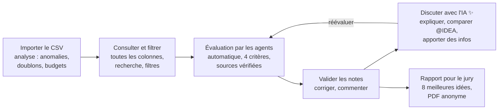
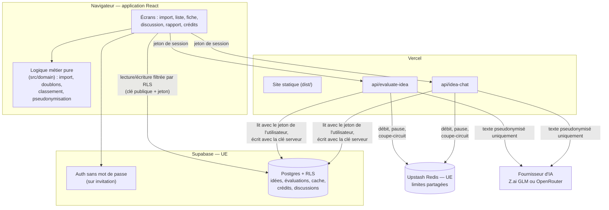
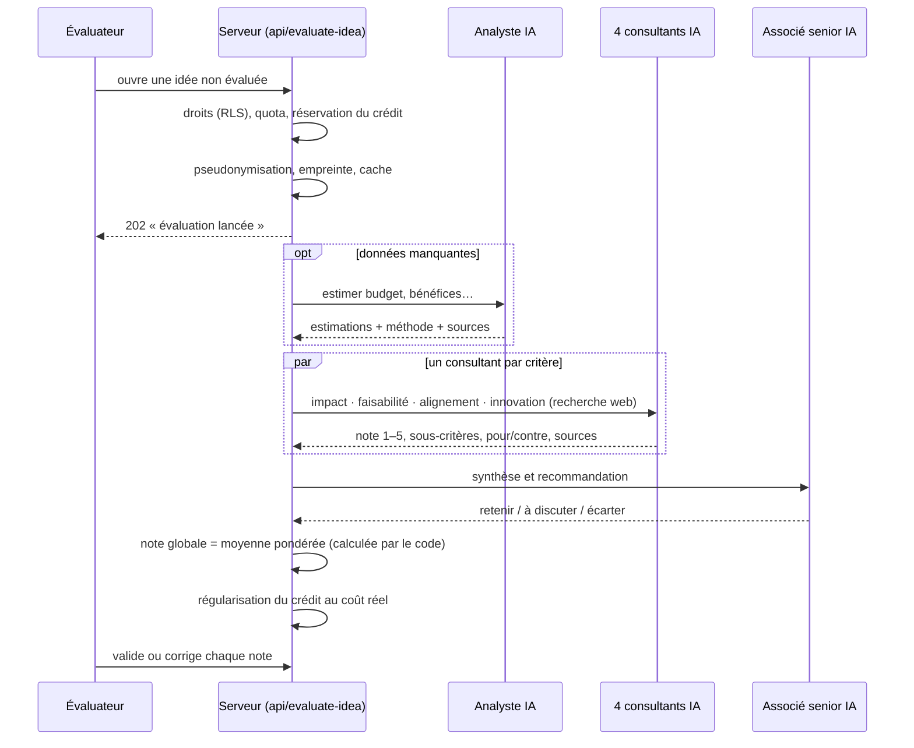
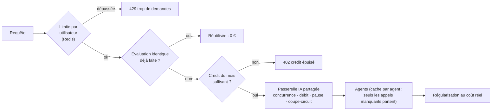

# Challenge Innovation — plateforme d'évaluation des idées

Application web qui aide un cabinet de conseil à **évaluer les idées déposées par les salariés
d'un client lors d'un challenge d'innovation interne**, puis à présenter une **shortlist argumentée
au jury**. Elle importe l'export du formulaire, repère les anomalies et les doublons, fait noter
chaque idée par une équipe d'agents IA (l'humain valide toujours la note finale) et produit un
rapport prêt à envoyer au client.

**Sommaire**

1. [Mise en route pas à pas](#1-mise-en-route-pas-à-pas)
2. [Utiliser l'application](#2-utiliser-lapplication)
3. [Cadrage du besoin](#3-cadrage-du-besoin)
4. [Architecture et décisions techniques](#4-architecture-et-décisions-techniques)
5. [Hypothèses](#5-hypothèses)
6. [Limites connues et suites](#6-limites-connues-et-suites)
7. [Déploiement sur Vercel](#7-déploiement-sur-vercel)
8. [Annexes : configuration détaillée](#8-annexes--configuration-détaillée)

---

## 1. Mise en route pas à pas

Comptez une trentaine de minutes la première fois.

### Ce qu'il vous faut

| Outil | Pourquoi | Lien |
|---|---|---|
| **Bun** 1.2 ou plus | installe, lance et teste l'application | https://bun.sh |
| **Git** | récupérer le code | https://git-scm.com |
| Un compte **Supabase** (gratuit) | base de données et connexion des utilisateurs | https://supabase.com |
| Une clé d'**IA** : Z.ai (modèles GLM) **ou** OpenRouter | notation des idées par les agents | https://z.ai · https://openrouter.ai |
| *(facultatif en local)* un compte **Upstash** (gratuit) | limitation de débit partagée, obligatoire en production | https://upstash.com |

### Étape 1 — Récupérer le projet et installer les dépendances

```bash
git clone https://github.com/firasayari10/INSKIP-platforme-innovation.git
cd INSKIP-platforme-innovation
bun install
```

### Étape 2 — Créer la base de données Supabase

1. Sur https://supabase.com, créez un projet (choisissez une **région européenne**).
2. Notez la **référence du projet** (dans l'adresse : `https://supabase.com/dashboard/project/<référence>`).
3. Reliez le projet puis créez les tables (les 5 migrations du dossier `supabase/migrations/`) :

   ```bash
   bunx supabase login
   bunx supabase link --project-ref <référence>
   bunx supabase db push --remote
   ```

   > `--remote` est indispensable : sans lui, la CLI vise une base locale.

### Étape 3 — Régler la connexion des utilisateurs (Supabase)

Dans le tableau de bord Supabase, menu **Authentication** :

1. **Sign In / Providers** : activez **Email** et **désactivez « Allow new users to sign up »**
   (l'accès se fait uniquement sur invitation).
2. **URL Configuration** : *Site URL* = `http://localhost:3000` ; *Redirect URLs* : ajoutez
   `http://localhost:3000/auth/callback`.
3. **Users → Add user → Create new user** : créez votre compte (cochez *Auto Confirm User*).

> Les modèles d'e-mail et l'envoi d'invitations demandent un SMTP : voir l'[annexe 8.1](#81-supabase--e-mails-et-invitations).

### Étape 4 — Renseigner les variables d'environnement

```bash
cp .env.example .env.local
```

Ouvrez `.env.local` et remplissez **au minimum** :

| Variable | Où la trouver |
|---|---|
| `BUN_PUBLIC_SUPABASE_URL` et `SUPABASE_URL` | Supabase → Project Settings → API → *Project URL* |
| `BUN_PUBLIC_SUPABASE_PUBLISHABLE_KEY` et `SUPABASE_PUBLISHABLE_KEY` | Supabase → Project Settings → API Keys → *Publishable key* |
| `SUPABASE_SECRET_KEY` | Supabase → API Keys → *Secret keys* (**jamais** dans une variable `BUN_PUBLIC_`) |
| `ZAI_API_KEY` **ou** (`LLM_PROVIDER=openrouter` + `OPENROUTER_API_KEY`) | console de votre fournisseur d'IA |
| `AI_PRICES_EUR_PER_MILLION` | le tarif réel de votre offre IA (sert au décompte des crédits) |

Les autres variables ont des valeurs par défaut prudentes (détail en [annexe 8.3](#83-variables-denvironnement)).
`.env.local` est ignoré par Git : **aucun secret ne doit être commité**.

### Étape 5 — Lancer l'application

```bash
bun dev
```

Ouvrez http://localhost:3000, saisissez votre adresse e-mail et cliquez sur le lien reçu.

### Étape 6 — Premier parcours (5 minutes)

1. **Créer un challenge** (ex. « Challenge innovation 2026 », client « Hexavia »).
2. **Importer** le fichier d'exemple `tests/fixtures/idees_hexavia.csv` : l'analyse signale
   40 idées, 6 doublons possibles et les anomalies (budgets manquants, date au format français…).
3. Ouvrir une idée : son **évaluation démarre automatiquement** (1 à 3 minutes).
4. Valider ou corriger les notes, discuter de la décision avec l'IA (✨).
5. Ouvrir **« Rapport pour le jury »** et l'enregistrer en PDF.

### Commandes utiles

| Commande | Rôle |
|---|---|
| `bun dev` | serveur de développement (rechargement automatique) |
| `bun test` | tests automatisés (aucun appel réseau : tout est simulé) |
| `bun run typecheck` | vérification des types TypeScript |
| `bun run build` | version de production dans `dist/` |
| `bunx supabase db push --remote` | appliquer les nouvelles migrations |
| `bun run scripts/check-redis-gate.ts` | vérifier les scripts de limitation sur une vraie base Upstash |

---

## 2. Utiliser l'application



| Écran | Ce qu'on y fait |
|---|---|
| **Vos challenges** | créer un challenge, voir le nombre d'idées |
| **Import** (3 étapes) | déposer le CSV, lire le rapport d'analyse (rejets, doublons, points d'attention), exclure une idée, enregistrer |
| **Page du challenge** | contexte stratégique du client, notation de toutes les idées en un clic, tableau complet avec filtres (direction, thème, site, anomalies, doublons) gardés dans l'adresse de la page |
| **Fiche d'une idée** | détail, auteur (visible ici seulement), évaluation détaillée par critère avec sources, validation humaine des notes, discussion ✨ |
| **Rapport pour le jury** | classement, fiche argumentée par idée, méthodologie, impression A4 / PDF |
| **🪙 Crédits** (en-tête) | crédit IA restant du mois et dernières consommations |

---

## 3. Cadrage du besoin

**Le problème.** La consultante dépouille une quarantaine d'idées à la main dans Excel avant un
jury : c'est long et sa notation manque de cohérence d'une idée à l'autre.

**Les utilisateurs.**

| Rôle | Profil | Usage |
|---|---|---|
| Évaluateur | consultant, **non technique** | importe, filtre, note, discute, exporte le rapport |
| Client / jury | destinataire du livrable | reçoit le rapport ; pas d'accès à l'application |
| Auteurs des idées | salariés du client | aucun accès ; ce sont **leurs données personnelles** qu'on protège |

**Ce qui est livré (V1).** Import CSV avec analyse ; liste filtrable de toutes les idées ;
notation automatique sur la grille du client (impact, faisabilité, alignement stratégique,
caractère innovant, de 1 à 5) avec une première note justifiée par l'IA, corrigeable ;
détection des doublons ; discussion avec l'IA sur une décision ; rapport final des 8 meilleures
idées. L'outil est **réutilisable** : plusieurs challenges, plusieurs clients, une grille par
challenge.

**Reporté (V2).** File de travaux serveur pour des milliers d'idées, doublons « sémantiques »
(même idée avec d'autres mots), export Excel, multi-évaluateurs, accès du jury, SSO.

---

## 4. Architecture et décisions techniques

### 4.1 Vue d'ensemble



**Principe directeur** : la logique métier est **pure** (`src/domain/`, sans réseau ni base) et
couverte par les tests ; le navigateur ne détient aucun secret ; seul le serveur (`api/`) connaît
les clés d'IA et la clé secrète Supabase.

### 4.2 Choix techniques

| Couche | Choix | Pourquoi |
|---|---|---|
| Outillage | **Bun** | un seul outil pour installer, tester et construire ; rapide |
| Interface | **React 19 + TypeScript strict**, Tailwind, shadcn/ui | composants accessibles, typage de bout en bout |
| Données et connexion | **Supabase** (Postgres, Auth, RLS), région UE | sécurité au niveau des lignes, pas de serveur à maintenir, données dans l'UE |
| Serveur | **Fonctions Vercel** (`api/`) | seul endroit qui voit les clés ; même dépôt, même déploiement |
| IA | **Z.ai (GLM)** ou **OpenRouter**, au choix (`LLM_PROVIDER`) | un modèle par rôle d'agent, recherche web intégrée |
| Limitation partagée | **Upstash Redis** (REST) | compteurs communs à toutes les instances serverless |
| Validation | **zod** à chaque frontière | fichier importé, réponses de l'IA et requêtes traités comme non fiables |
| Hébergement | **Vercel** | une URL, prévisualisations, en-têtes de sécurité |

### 4.3 Modèle de données


- **La grille est stockée en lignes** (`criteria`) : un nouveau client = de nouvelles données, pas
  de migration.
- **Les données personnelles sont isolées** (`idea_authors`) : jamais envoyées à l'IA, absentes du
  rapport.
- **La note IA et la note humaine sont séparées** (`criterion_assessments` / `scores`) : l'IA ne
  peut jamais écrire une note finale.
- **RLS sur toutes les tables** : un utilisateur ne voit que les challenges dont il est membre ; les
  résultats des agents, le cache et les crédits ne sont **écrits que par le serveur**.
- 5 migrations versionnées (`supabase/migrations/`), chacune testée (`supabase/tests/`, 351 tests).

### 4.4 Import et détection des anomalies

L'analyse se fait **dans le navigateur, avant tout enregistrement** (`src/domain/importAnalysis.ts`) :
en-têtes tolérants, séparateur `;` ou `,`, BOM et encodage Windows détectés, lignes vides
ignorées, lignes invalides rejetées avec leur numéro, budgets convertis (« 15k€ » → 15 000 €, saisie
d'origine conservée), dates françaises converties, cellules « formule » signalées. Les doublons
sont repérés par **similarité TF-IDF** (exacts et formulations proches, jamais fusionnés
automatiquement). L'enregistrement est **atomique** (fonction `import_ideas`) et un réimport met à
jour sans dupliquer.

### 4.5 Notation par une équipe d'agents



- **Cohérence** : mêmes consignes versionnées, échelle 1–5 décrite par critère, réponses au
  **format imposé** et vérifiées ; une réponse non conforme est redemandée une fois puis rejetée —
  aucune note n'est inventée.
- **Sources vérifiables** : une source n'est affichée que si l'agent l'a réellement trouvée par sa
  recherche web.
- **L'humain décide** : la note IA est une proposition, la note finale est validée par l'évaluateur.
- **Contexte client** : sans stratégie fournie, un contexte supposé est utilisé et signalé (voir §5).
- **Discussion ✨** : expliquer une note, comparer avec `@IDEA-xxx`, apporter des informations,
  puis « Réévaluer avec ces informations ».

### 4.6 Données personnelles et biais

Avant **tout** envoi à l'IA, `src/domain/pseudonymize.ts` remplace les noms des auteurs du
challenge par des jetons stables (`[PERSONNE_1]`…), et masque civilités, e-mails, téléphones,
IBAN, numéros de sécurité sociale, matricules et âges. Objectif double : **RGPD** et
**neutralité** (l'IA juge l'idée, pas la personne). Les montants, dates, sites et directions sont
conservés. Les fournisseurs qui réutilisent les données sont exclus (OpenRouter), le contenu d'une
idée est déclaré comme **donnée** et jamais comme consigne (protection contre l'injection de
consignes), et le rapport final est anonyme.

### 4.7 Coûts et robustesse



| Mécanisme | Effet |
|---|---|
| **Cache par agent** (`agent_outputs`) | une requête identique dans le même challenge n'est pas repayée ; une évaluation interrompue reprend sans rappeler les agents déjà terminés ; les doublons exacts partagent leurs analyses ; jamais de partage entre clients |
| **Crédits** : 5 € / utilisateur / mois | réservation du pire cas avant l'appel, régularisation au coût réel, refus clair si épuisé ; journal immuable ; indicateur 🪙 dans l'en-tête |
| **Passerelle IA** (Upstash) | au plus 2 appels simultanés et 20/min pour toutes les instances, pause générale sur saturation, coupe-circuit après 5 échecs ; repli en mémoire si Redis ne répond pas |
| **Limites par utilisateur** | 30 requêtes/min, 60 évaluations/h, 120 messages/h |

### 4.8 Qualité

- **358 tests applicatifs** (`bun test`) et **351 tests de base de données** (pgTAP) ; les tests
  **n'appellent jamais** le fournisseur d'IA (réponses simulées, réseau sortant bloqué).
- **Intégration continue** : types, tests et build à chaque push (`.github/workflows/ci.yml`).
- Les décisions structurantes sont tracées dans `docs/adr/` :

| ADR | Décision |
|---|---|
| [0001](docs/adr/0001-authentification.md) | connexion sans mot de passe, sur invitation, liens `token_hash` |
| [0002](docs/adr/0002-notation-par-agents.md) | équipe d'agents, sources vérifiées, pseudonymisation, discussion |
| [0003](docs/adr/0003-cache-credits-debit-resilience.md) | cache par agent, crédits, limitation partagée, résilience |

---

## 5. Hypothèses

Aucune question ne pouvant être posée au client, ces hypothèses ont été retenues :

- **Format du fichier** : CSV (`;` ou `,`, UTF-8 ou Windows-1252), 5 Mo et 2 000 lignes au plus ;
  colonnes `id`, `date_depot`, `prenom`, `nom`, `direction`, `site`, `theme`, `titre`,
  `description`, `benefices_attendus`, `budget_estime` ; obligatoires : `id`, `titre`,
  `description`. Un réimport met à jour les idées de même identifiant.
- **Données personnelles** : `prenom` et `nom` sont les seules du fichier ; isolées, jamais
  envoyées à l'IA, absentes de la liste (minimisation) et du rapport ; visibles sur la fiche.
- **Contexte du client supposé** (remplaçable sur la page du challenge par le contexte réel) :

  > Groupe industriel français spécialisé dans la fabrication d'équipements et de composants
  > industriels, environ 4 000 salariés répartis sur 8 sites de production en France et en Europe.
  > Stratégie RSE : réduire les émissions de CO₂ de 30 % d'ici 2030, améliorer l'efficacité
  > énergétique des sites et renforcer la sécurité au travail, avec un objectif de zéro accident grave.
  > Stratégie financière : gagner 2 points de marge opérationnelle sur les trois prochaines années,
  > en privilégiant les investissements à retour rapide (ROI inférieur à 3 ans).
  > Priorités : amélioration de la performance industrielle, réduction des arrêts de production,
  > maintenance prédictive, automatisation des processus, digitalisation des ateliers et
  > fidélisation des talents.

- **Grille** : 4 critères de même poids par défaut (modifiables en base), notes de 1 à 5.
- **Shortlist** : 8 idées, classées sur la note validée par le consultant, sinon sur la note
  proposée par l'IA (signalée) ; un doublon confirmé est regroupé avec l'idée mieux classée.
- **Doublons** : contenu identique ou formulation proche (similarité ≥ 28 %) ; la même idée
  exprimée avec d'autres mots n'est pas détectée.
- **Crédits** : 5 € par utilisateur et par mois calendaire (heure de Paris) ; recrédit par
  l'opérateur uniquement.
- **Sources** : uniquement des pages publiques réellement trouvées par la recherche web.
- **Évaluateurs** : un évaluateur par challenge en V1 ; le modèle permet d'en ajouter.
- Toutes les données de développement et de démonstration sont **fictives**.

---

## 6. Limites connues et suites

| Limite | Conséquence | Suite prévue |
|---|---|---|
| Notation par lot pilotée par le navigateur | l'onglet doit rester ouvert ; lent pour des milliers d'idées | file de travaux serveur (ADR 0003 §4, conçue, reportée) |
| Doublons lexicaux seulement | une même idée reformulée peut échapper | doublons par embeddings |
| Envoi d'e-mails Supabase intégré | 2 e-mails/heure, invitations inopérantes | configurer un SMTP (annexe 8.1) |
| Clé GLM « Coding Plan » en local | pas de recherche web, usage hors outils de code à vérifier | clé API standard avec crédit en production |
| Preview et production partagent la base | données de test mêlées aux vraies | projet Supabase distinct pour les previews |
| Export | PDF via l'impression du navigateur | export Excel |

---

## 7. Déploiement sur Vercel

Le dépôt est prêt (`vercel.json` : build Bun, fonctions `api/`, en-têtes de sécurité CSP/HSTS).
Plan complet et recette : [docs/deploiement-vercel.md](docs/deploiement-vercel.md).

**Avant de commencer** : clé d'IA de **production** (API standard avec crédit, pas la clé Coding
Plan), barème réel des modèles, SMTP configuré dans Supabase, base Upstash en région UE.

1. **Relier le projet**

   ```bash
   bunx vercel login
   bunx vercel link
   ```

   Dans les réglages du projet Vercel, choisissez une **région UE** pour les fonctions (ex. `fra1`).

2. **Saisir les variables d'environnement** (Project Settings → Environment Variables), sans
   jamais les commiter : `BUN_PUBLIC_SUPABASE_URL`, `BUN_PUBLIC_SUPABASE_PUBLISHABLE_KEY`,
   `SUPABASE_URL`, `SUPABASE_PUBLISHABLE_KEY`, `SUPABASE_SECRET_KEY`, `LLM_PROVIDER` + la clé
   d'IA, `AI_PRICES_EUR_PER_MILLION`, `UPSTASH_REDIS_REST_URL`, `UPSTASH_REDIS_REST_TOKEN`,
   `APP_URL=https://<votre-domaine>`. Ne définissez **pas** `ZAI_BASE_URL` (point d'entrée
   standard en production).

3. **Mettre la base à jour** si de nouvelles migrations existent :

   ```bash
   bunx supabase db push --remote
   ```

4. **Régler Supabase pour le domaine** (Authentication → URL Configuration) : *Site URL* =
   `https://<votre-domaine>`, *Redirect URLs* += `https://<votre-domaine>/auth/callback`.

5. **Déployer une prévisualisation** et la recetter :

   ```bash
   bunx vercel
   ```

   Connexion (lien et code), invitation, import du CSV d'exemple, évaluation d'une idée (vérifier
   🪙 avant/après), discussion avec `@IDEA-xxx`, rapport en PDF, en-têtes de sécurité :

   ```bash
   curl -sI https://<url-de-preview>/ | grep -iE "content-security|strict-transport|x-frame"
   ```

   Puis Supabase → *Advisors* → *Security* : aucun nouvel avertissement.

6. **Mettre en production**

   ```bash
   bunx vercel --prod
   ```

7. **En cas de problème** : `bunx vercel rollback` revient au déploiement précédent.

> En production, l'application **refuse de démarrer sans Upstash** (`service_non_configure`) et
> **refuse toute clé secrète exposée au navigateur** : une erreur de configuration se voit
> immédiatement.

---

## 8. Annexes : configuration détaillée

### 8.1 Supabase : e-mails et invitations

L'envoi intégré de Supabase est limité (2 e-mails/heure, uniquement vers les membres de
l'organisation) et **ne permet pas de modifier les modèles**. Configurez un SMTP (ex. Brevo,
gratuit jusqu'à 300 e-mails/jour) dans *Authentication → Emails → SMTP Settings*, puis :

**Magic Link** (lien + code, fonctionne dans tout navigateur) :

```html
<h2>Connexion à Challenge Innovation</h2>
<p><a href="{{ .RedirectTo }}&token_hash={{ .TokenHash }}&type=email">Se connecter</a></p>
<p>Ou saisissez ce code : <strong>{{ .Token }}</strong></p>
<p>Ce lien et ce code sont valables une heure. Si vous n'êtes pas à l'origine de cette demande, ignorez cet e-mail.</p>
```

**Invite user** :

```html
<h2>Vous êtes invité sur Challenge Innovation</h2>
<p>Vous avez été invité à évaluer les idées d'un challenge d'innovation.</p>
<p><a href="{{ .SiteURL }}/auth/callback?token_hash={{ .TokenHash }}&type=invite">Accepter l'invitation</a></p>
<p>Ce lien est valable 24 heures. Ensuite, connectez-vous simplement avec votre adresse e-mail.</p>
```

Puis *Authentication → Users → Invite user* pour chaque évaluateur (aucun mot de passe).

### 8.2 Fournisseur d'IA

| Fournisseur | Variables | Remarques |
|---|---|---|
| **Z.ai (GLM)** — par défaut si `ZAI_API_KEY` est défini | `ZAI_API_KEY`, `ZAI_MODEL_ANALYSTE/CONSULTANT/ASSOCIE` (défaut `glm-5.2`), `ZAI_THINKING` | recherche web intégrée sur l'API standard ; une clé « Coding Plan » exige `ZAI_BASE_URL=https://api.z.ai/api/coding/paas/v4` et n'a pas de recherche web |
| **OpenRouter** | `LLM_PROVIDER=openrouter`, `OPENROUTER_API_KEY`, `OPENROUTER_MODEL_*` | fournisseurs qui conservent les données exclus ; fixez un plafond de dépense |

### 8.3 Variables d'environnement

La liste complète, commentée, est dans [`.env.example`](.env.example). Principales valeurs par
défaut : `LLM_MAX_CONCURRENT=2`, `LLM_REQUESTS_PER_MINUTE=20`, `LLM_TIMEOUT_MS=180000`,
`API_REQUESTS_PER_MINUTE_PER_USER=30`, `EVALUATIONS_PER_HOUR=60`, `CHAT_MESSAGES_PER_HOUR=120`,
`AGENT_CACHE_MAX_AGE_DAYS=90`, `WEB_MAX_RESULTS=5`. Seules les variables préfixées `BUN_PUBLIC_`
sont envoyées au navigateur : elles doivent être publiques par nature.

### 8.4 Sécurité en bref

- Aucun secret dans le dépôt ; `.env.local` ignoré ; données hébergées dans l'UE (Supabase
  `eu-north-1`, Upstash UE).
- RLS sur toutes les tables, écritures sensibles réservées au serveur, journal de crédits immuable.
- Pseudonymisation de tout texte envoyé à l'IA ; aucune donnée personnelle dans les journaux ni
  dans Redis.
- En-têtes de sécurité en production (CSP, HSTS, X-Frame-Options, nosniff, Permissions-Policy).
- Règles détaillées : [CLAUDE.md](CLAUDE.md) §7.
