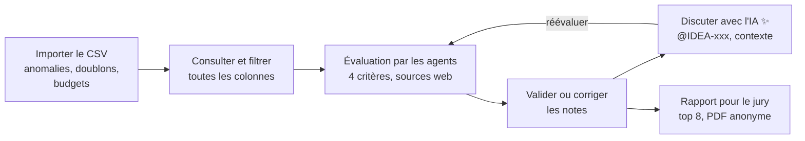
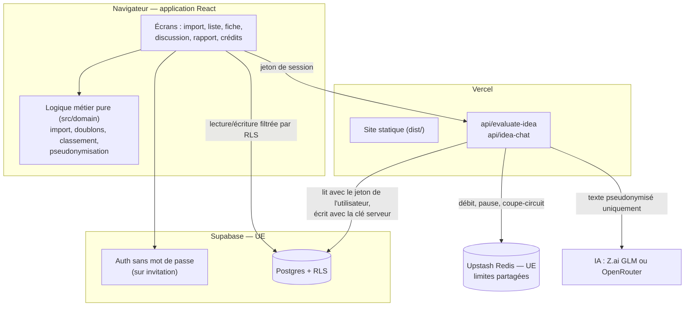
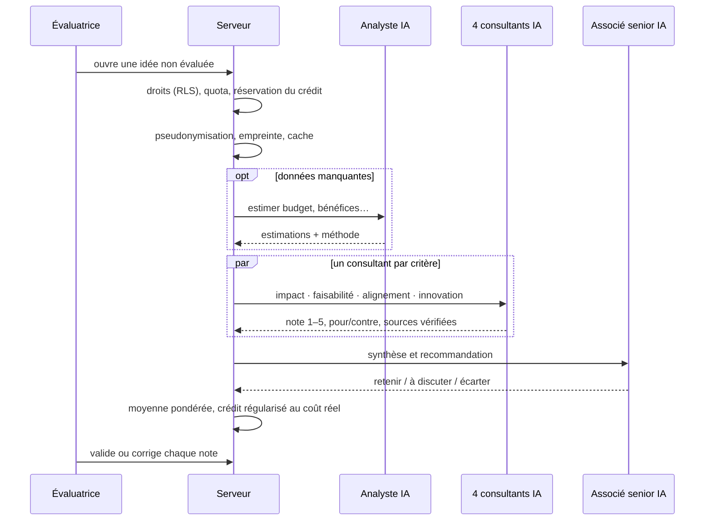
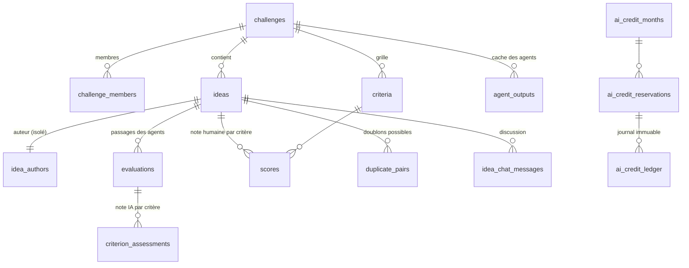

# Challenge Innovation

Outil qui aide un cabinet de conseil à **dépouiller les idées d'un challenge d'innovation
interne** : import de l'export du formulaire, détection des anomalies et des doublons, notation
de chaque idée par une équipe d'agents IA (l'humain valide toujours la note finale), puis
**rapport des 8 meilleures idées** prêt à présenter au jury.

---

## Aperçu

**URL de l'application** : https://innovationplatform-jet.vercel.app (accès sur invitation).

| Liste des idées et filtres | Fiche d'une idée et évaluation des agents | Rapport pour le jury |
|---|---|---|
| _capture : `docs/captures/liste.png`_ | _capture : `docs/captures/fiche.png`_ | _capture : `docs/captures/rapport.png`_ |

<!-- Remplacer chaque cellule par  une fois les captures ajoutées. -->



---

## Lancer l'outil

Prérequis : [Bun](https://bun.sh) 1.2+, Git, un projet [Supabase](https://supabase.com) (région
UE) et une clé d'IA ([Z.ai](https://z.ai) ou [OpenRouter](https://openrouter.ai)).

```bash
# 1. Récupérer et installer
git clone https://github.com/firasayari10/INSKIP-platforme-innovation.git
cd INSKIP-platforme-innovation
bun install

# 2. Créer les tables dans votre projet Supabase (5 migrations)
bunx supabase login
bunx supabase link --project-ref <référence-du-projet>
bunx supabase db push --remote

# 3. Configurer
cp .env.example .env.local     # puis remplir les 5 valeurs ci-dessous

# 4. Lancer
bun dev                        # http://localhost:3000
```

| Variable de `.env.local` | Où la trouver |
|---|---|
| `BUN_PUBLIC_SUPABASE_URL`, `SUPABASE_URL` | Supabase → Project Settings → API → *Project URL* |
| `BUN_PUBLIC_SUPABASE_PUBLISHABLE_KEY`, `SUPABASE_PUBLISHABLE_KEY` | Supabase → API Keys → *Publishable key* |
| `SUPABASE_SECRET_KEY` | Supabase → API Keys → *Secret keys* (**jamais** en `BUN_PUBLIC_`) |
| `ZAI_API_KEY` (ou `LLM_PROVIDER=openrouter` + `OPENROUTER_API_KEY`) | console du fournisseur d'IA |

Dans Supabase → **Authentication** : *URL Configuration* → Site URL `http://localhost:3000`,
Redirect URL `http://localhost:3000/auth/callback` ; *Users → Add user* pour créer votre compte
(*Auto Confirm*). Connectez-vous avec votre e-mail, créez un challenge et importez
`tests/fixtures/idees_hexavia.csv` (40 idées fictives).

| Commande | Rôle |
|---|---|
| `bun dev` | serveur de développement |
| `bun test` | tests (aucun appel réseau, IA simulée) |
| `bun run typecheck` | vérification des types |
| `bun run build` | version de production dans `dist/` |

---

## 1. Cadrage

**Le besoin en 5 lignes.** Camille, consultante, doit préparer le jury d'un challenge
d'innovation interne chez Hexavia. Elle reçoit ~40 idées dans un export CSV hétérogène (budgets en
texte libre, champs vides, doublons). Aujourd'hui elle les dépouille à la main dans Excel : c'est
long et sa notation manque de cohérence d'une idée à l'autre. Elle a besoin de tout voir, filtrer,
noter sur 4 critères avec une aide de l'IA qu'elle corrige, repérer les doublons et sortir une
shortlist d'environ 8 idées argumentée pour le jury.

**Utilisateurs.**

| Rôle | Profil | Usage |
|---|---|---|
| Évaluatrice (Camille) | consultante, **non technique**, habituée à Excel | importe, filtre, note, discute, exporte le rapport |
| Client / jury | destinataire du livrable | reçoit le rapport PDF ; pas d'accès |
| Auteurs des idées | salariés d'Hexavia | aucun accès ; ce sont **leurs données personnelles** qu'on protège |

**Mes hypothèses.**
- **Fichier** : CSV `;` ou `,`, UTF-8 (BOM) ou Windows-1252, ≤ 5 Mo et 2 000 lignes ; colonnes de
  l'export Hexavia ; obligatoires : `id`, `titre`, `description`. Un réimport met à jour sans
  dupliquer.
- **Données personnelles** : `prenom` et `nom` sont les seules ; isolées en base, jamais envoyées à
  l'IA, absentes de la liste et du rapport.
- **Contexte client** inconnu : les agents notent avec un **contexte supposé**, signalé comme tel et
  remplaçable sur la page du challenge :

  > Groupe industriel français spécialisé dans la fabrication d'équipements et de composants
  > industriels, environ 4 000 salariés répartis sur 8 sites de production en France et en Europe.
  > Stratégie RSE : réduire les émissions de CO₂ de 30 % d'ici 2030, améliorer l'efficacité
  > énergétique des sites et renforcer la sécurité au travail, avec un objectif de zéro accident grave.
  > Stratégie financière : gagner 2 points de marge opérationnelle sur les trois prochaines années,
  > en privilégiant les investissements à retour rapide (ROI inférieur à 3 ans).
  > Priorités : amélioration de la performance industrielle, réduction des arrêts de production,
  > maintenance prédictive, automatisation des processus, digitalisation des ateliers et
  > fidélisation des talents.

- **Grille** : 4 critères de même poids, notes 1 à 5. **Shortlist** : 8 idées, classées sur la note
  validée, sinon sur la note IA (signalée) ; un doublon confirmé est regroupé avec la mieux classée.
- **Doublons** : texte identique ou proche (similarité ≥ 28 %) ; jamais de fusion automatique.
- **Coût IA** : 5 € de crédit par utilisateur et par mois.
- Un évaluateur par challenge ; idées en français ; toutes les données de démo sont fictives.

**V1 (livrée)** : connexion sur invitation ; import CSV avec rapport d'anomalies ; liste complète
filtrable (direction, thème, site, anomalies, doublons) et fiche par idée ; notation automatique
par agents avec justification détaillée et sources web ; validation humaine ; discussion ✨ avec
l'IA (`@IDEA-xxx`) ; doublons ; rapport top 8 imprimable en PDF ; crédits IA et limites de débit.

**Attendra (V2)** : export Excel, doublons sémantiques (embeddings), file de travaux serveur pour
des milliers d'idées, multi-évaluateurs et calibration, accès du jury, SSO, administration des
grilles.

---

## 2. Conception

### Architecture



| Choix | Raison |
|---|---|
| **Logique métier pure** dans `src/domain/` (sans réseau ni base) | testable vite et de façon déterministe ; c'est là que vivent les règles qui comptent |
| **Pas de backend dédié** : le navigateur lit Supabase directement, sous RLS | moins de code et d'infrastructure ; la sécurité est garantie par la base, pas par le front |
| **Deux fonctions serveur seulement** (`api/`) | seul endroit qui connaît les clés d'IA et la clé secrète ; le navigateur n'a aucun secret |
| **Équipe d'agents** : analyste → 4 consultants (un par critère, recherche web) → associé senior | un agent spécialisé par critère explique mieux sa note ; l'associé repère les incohérences |
| **Note globale calculée par le code** (moyenne pondérée), jamais par l'IA | reproductible et explicable |
| **Pseudonymisation** avant tout envoi à l'IA | RGPD et neutralité : l'IA juge l'idée, pas la personne |
| **Cache par agent + crédits + limites partagées** | coût maîtrisé, pas de double paiement, résistance aux saturations du fournisseur |

### Notation par les agents



Une réponse d'IA hors format est redemandée une fois puis rejetée (aucune note inventée) ; une
source n'est gardée que si elle figure dans les résultats réels de la recherche web ; le texte de
l'idée est déclaré comme **donnée**, jamais comme consigne (protection contre l'injection).

### Modèle de données



| Choix | Raison |
|---|---|
| Grille stockée **en lignes** (`criteria`) | un nouveau client = des données, pas une migration |
| Auteurs **isolés** (`idea_authors`) | une seule table à protéger ; rien ne part à l'IA ni au rapport par erreur |
| Note IA (`criterion_assessments`) **séparée** de la note humaine (`scores`) | l'IA ne peut jamais écrire une note finale |
| **RLS** sur toutes les tables ; résultats IA, cache et crédits écrits par le serveur seul | un utilisateur ne voit que ses challenges et ne peut pas falsifier une évaluation ou son crédit |
| Import **atomique** (fonction `import_ideas`) et idempotent (`external_ref` unique) | pas d'import à moitié fait ; un réimport ne duplique pas |
| Budget brut **et** normalisé (`budget_raw`, `budget_eur`) | « 15k€ » devient 15 000 € sans perdre la saisie d'origine |

### Stack

| Couche | Choix | Raison |
|---|---|---|
| Outillage | **Bun** | un seul outil pour installer, tester et construire |
| Interface | **React 19 + TypeScript strict**, Tailwind, shadcn/ui | composants accessibles, typage de bout en bout |
| Données / Auth | **Supabase** (Postgres, Auth, RLS), région UE | sécurité au niveau des lignes, rien à héberger, données dans l'UE |
| Serveur | **Fonctions Vercel** | même dépôt, même déploiement que le front |
| IA | **Z.ai GLM** ou **OpenRouter** (`LLM_PROVIDER`) | modèle par rôle d'agent, recherche web intégrée |
| Limites partagées | **Upstash Redis** (REST) | compteurs communs à toutes les instances serverless |
| Validation | **zod** à chaque frontière | fichier, réponses IA et requêtes sont traités comme non fiables |

Décisions détaillées : [ADR 0001](docs/adr/0001-authentification.md) (authentification),
[ADR 0002](docs/adr/0002-notation-par-agents.md) (agents),
[ADR 0003](docs/adr/0003-cache-credits-debit-resilience.md) (cache, crédits, résilience).

---

## 3. Construction avec l'IA

**Assistant utilisé** : **Claude Code** (modèle Claude Opus) dans VS Code, avec des sous-agents
spécialisés (architecte base de données, architecte backend, revue de code, sécurité…) et le
serveur MCP Supabase **en lecture seule** pour inspecter le schéma et les journaux. Les règles du
projet sont écrites dans [`CLAUDE.md`](CLAUDE.md) : boucle cadrer → explorer → planifier → tester
→ implémenter → vérifier, checklist sécurité, et **aucun commit sans mon accord**.

**Mes prompts les plus utiles** (reformulés) :

1. **Poser le cadre avant le code** — « Écris un CLAUDE.md comme un ingénieur IA senior : façons de
   penser et processus à respecter pour que l'implémentation soit efficace, sécurisée et testée ;
   structure le dépôt avant de construire quoi que ce soit. » → toutes les sessions suivantes ont
   suivi les mêmes règles (tests d'abord, RLS, pas de secret, demander avant de commiter).
2. **Import avec analyse** — « Upload du CSV → analyse des données (doublons, lignes vides…) →
   stockage dans Supabase, avec l'agent database-architect et des migrations via la CLI. » → rapport
   d'anomalies ligne à ligne avant tout enregistrement.
3. **Agents de notation** — « Des agents, un par critère, orchestrés par un consultant senior, qui
   recherchent de vraies sources (rapports, analyses de marché), expliquent la note en détail, et
   estiment logiquement les données manquantes ; on est dans un contexte de conseil. »
4. **Protéger les personnes** — « Avant d'envoyer une idée au LLM, il faut une pseudonymisation qui
   enlève les données sensibles pour enlever les biais. »
5. **Maîtriser le coût** — « Cache des notes déjà attribuées, Redis pour la limitation de débit,
   un crédit de 5 € par utilisateur avec un indicateur de consommation ; ne teste pas avec la clé
   GLM, simule les réponses. »

**Un moment où l'IA s'est trompée.** En testant l'application à la main, une évaluation échouait
toujours avec « La dernière évaluation n'a pas abouti » après de longues minutes d'attente. Le
code écrit par l'IA traitait toute réponse HTTP 429 du fournisseur comme une **saturation
temporaire** et réessayait. En lisant les journaux du serveur, on a vu que Z.ai renvoyait en
réalité le code **1113 (« solde insuffisant »)**… avec un statut 429. L'IA avait supposé que 429
voulait toujours dire « trop de requêtes ». Correctif : lire le code d'erreur du fournisseur
**avant** le statut HTTP, échouer immédiatement avec un message clair, et un test qui reproduit ce
cas. Autre exemple, détecté par un test : le cache des évaluations ne servait jamais, car Postgres
(`jsonb`) réordonne les clés des objets et la comparaison échouait ; remplacé par une empreinte
SHA-256 calculée sur un JSON canonique.

J'ai aussi **refusé** une proposition de l'IA : une refonte « façon Excel » de l'interface, moins
lisible ; elle a été annulée (commit « Revient au design précédent »).

---

## 4. Fiabilisation

**Ce que j'ai testé et pourquoi** — en priorité la logique qui fait le résultat livré au jury :

| Zone | Fichiers | Pourquoi |
|---|---|---|
| **Import** | `import-analysis`, `import-fields`, `import-hexavia` (le vrai format, fictif) | un export mal lu fausse tout le reste : BOM, séparateurs, en-têtes variables, lignes vides ou invalides isolées, budgets « 15k€ », dates françaises, cellules formule, réimport idempotent |
| **Notation** | `scoring`, `evaluate-idea`, `evaluate-handler`, `zai-client` | moyenne pondérée, bornes 1–5, réponse IA invalide rejetée, sources non vérifiées écartées, note humaine jamais écrasée, erreurs du fournisseur (429, 1113, délai) |
| **Doublons** | `similarity` | reformulations détectées, faux positifs écartés, symétrie, textes vides |
| **Shortlist** | `shortlist` | taille respectée, note validée prioritaire, doublons regroupés, départage stable des égalités |
| **Données personnelles** | `pseudonymize` | noms, e-mails, téléphones, IBAN, âges masqués avant l'IA |
| **Coût et robustesse** | `cache`, `credits`, `gate`, `rate-limiter`, `batch` | pas de double paiement, crédit jamais négatif, limites et coupe-circuit |
| **Sécurité / accès** | `auth`, `chat-handler`, `config` | jeton obligatoire (401), entrées invalides (400), clé secrète refusée côté navigateur |
| **Base de données** | `supabase/tests/*.test.sql` (pgTAP, 351 tests) | RLS : un utilisateur ne voit que ses challenges ; l'IA n'écrit pas les notes finales ; journal de crédits immuable |

**358 tests applicatifs**, aucun appel réseau : un préchargement (`tests/setup/no-network.ts`)
bloque toute sortie, les réponses de l'IA sont simulées. Les tests pgTAP sont lancés à la main
contre une base Postgres de test.

**Ce que fait la CI** ([`.github/workflows/ci.yml`](.github/workflows/ci.yml)), à chaque push et
chaque pull request : `bun install --frozen-lockfile` → `bun run typecheck` → `bun test` →
`bun run build`. Un échec bloque la fusion. Tous les pushes du projet sont passés au vert.

---

## 5. Livraison

### Configuration

Toute la configuration passe par des **variables d'environnement** (liste commentée :
[`.env.example`](.env.example)) ; aucun secret dans le dépôt (`.env.local` est ignoré). Seules les
variables `BUN_PUBLIC_*` vont au navigateur et sont publiques par nature ; l'application **refuse
de démarrer** si une clé secrète y est placée, ou si Upstash manque en production.

| Réglage | Variables | Défaut |
|---|---|---|
| Fournisseur d'IA | `LLM_PROVIDER`, `ZAI_API_KEY` / `OPENROUTER_API_KEY`, `*_MODEL_*` | `zai`, `glm-5.2` |
| Barème (crédits) | `AI_PRICES_EUR_PER_MILLION` | indicatif, **à remplacer** |
| Débit vers l'IA | `LLM_MAX_CONCURRENT`, `LLM_REQUESTS_PER_MINUTE`, `LLM_TIMEOUT_MS` | 2, 20/min, 180 s |
| Quotas par utilisateur | `API_REQUESTS_PER_MINUTE_PER_USER`, `EVALUATIONS_PER_HOUR`, `CHAT_MESSAGES_PER_HOUR` | 30, 60, 120 |
| Limites partagées | `UPSTASH_REDIS_REST_URL`, `UPSTASH_REDIS_REST_TOKEN` | obligatoires en production |
| Contexte client | page du challenge (pas de variable) | contexte supposé (§1) |

### Ce qui manque avant de le confier à Camille

- **SMTP** dans Supabase (ex. Brevo) : sans lui, 2 e-mails/heure et pas d'invitation fiable.
- **Clé d'IA de production** (API standard avec crédit) : la clé de test « Coding Plan » n'a pas
  de recherche web.
- **Barème réel** des modèles, pour que le crédit de 5 € corresponde à une vraie dépense.
- **Recette complète** sur https://innovationplatform-jet.vercel.app, avec le vrai contexte
  stratégique d'Hexavia saisi.
- **Base séparée** pour les prévisualisations (aujourd'hui partagée avec la production).
- **Export Excel** de la shortlist (aujourd'hui : PDF via l'impression).
- Une courte **prise en main** avec Camille (30 min) sur un vrai fichier.

---

## 6. Journal

Journée du 15 novembre 2026 (heures des commits).

| Heure | Étape |
|---|---|
| 15:00 | Lecture du besoin, initialisation du dépôt (Bun, React, TypeScript) |
| 15:30 | Structure du dépôt et `CLAUDE.md` (règles de travail de l'assistant) |
| 15:36 | CI GitHub Actions ; connexion sans mot de passe sur invitation |
| 16:01 | Connexion par invitation corrigée et testée à la main |
| 16:26 | Import CSV avec rapport d'analyse et détection des anomalies |
| 16:56 | Essai d'une interface « façon Excel »… |
| 17:15 | … abandonné : retour au design précédent ; filtres, toutes les colonnes, fiche par idée |
| 17:52 | Notation par une équipe d'agents IA (recherche web, sources vérifiées, estimations) |
| 18:20 | Discussion ✨ avec l'IA sur la fiche d'une idée, mentions `@IDEA-xxx` |
| 18:34 | Cache des sorties d'agents |
| 18:41 | Pseudonymisation des textes envoyés à l'IA |
| 18:52 | Crédits IA de 5 € par utilisateur et par mois |
| 19:00 | Limitation de débit partagée (Upstash Redis) |
| 19:20 | Rapport final du top 8 pour le jury ; préparation du déploiement Vercel |

---

## 7. Suite et questions pour Camille

**Avec une journée de plus**
- Faire la recette complète sur l'URL en ligne et une séance de test avec Camille.
- **Export Excel** de la shortlist et de toutes les notes (format qu'elle manipule déjà).
- **Jeu d'évaluation du prompt** (`tests/evals/`) : 10 idées annotées, mesurer l'écart et la
  stabilité des notes (même idée notée 3 fois).
- **Doublons sémantiques** (embeddings `pgvector`) pour les reformulations.
- **File de travaux côté serveur** pour noter des centaines d'idées sans garder l'onglet ouvert.
- Un test de bout en bout du parcours complet (import → note → rapport).

**Questions que je poserais à Camille**
1. Quelle est la **stratégie réelle d'Hexavia** (priorités, objectifs chiffrés) ? Elle remplacerait
   le contexte supposé et change directement les notes d'alignement.
2. Les 4 critères ont-ils le **même poids** ? Le jury en privilégie-t-il un ?
3. Le jury doit-il voir le **nom des auteurs** dans le rapport, ou rester anonyme ?
4. Quel **format** attend le jury : PDF, Excel, présentation ? Combien d'idées exactement ?
5. Les salariés ont-ils été informés que leurs idées seraient **analysées par une IA** (même
   pseudonymisées) ? Combien de temps garder les données après le jury ?
6. Travaillera-t-elle **seule** ou avec d'autres consultants (notes à croiser, calibration) ?
7. Quel **budget IA** par challenge est acceptable ?
