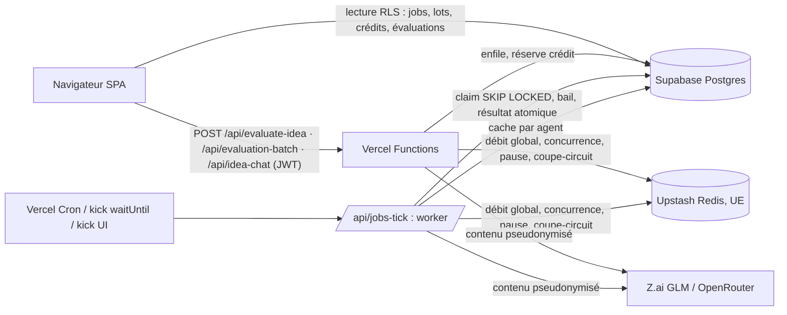

# ADR 0003 — Cache des évaluations, crédits IA, limitation de débit distribuée et file de travaux

- **Statut** : proposée (conception ; rien n'est implémenté)
- **Date** : 2026-11-15
- **Complète** : [ADR 0002](0002-notation-par-agents.md)
- **À valider par l'humain avant implémentation** (CLAUDE.md §6) : nouvelles dépendances
  (`@upstash/redis`, `@upstash/ratelimit`, `@vercel/functions`), nouveau service externe (Upstash
  Redis), quatre migrations, toute modification des consignes de notation (§5).

---

## Contexte

### Ce qui existe (lu dans le code)

| Sujet | État actuel | Fichier |
|---|---|---|
| Cache | Évaluation réutilisée si même `idea_id` + `content_hash` + `PROMPT_VERSION` + `models` | `src/server/evaluateHandler.ts` |
| Exécution | 202 puis travail « en arrière-plan » dans la requête ; `background` jamais fourni | `api/evaluate-idea.ts` |
| Lot | Boucle dans le navigateur, 2 idées à la fois | `src/features/scoring/BatchEvaluationBar.tsx`, `src/domain/batch.ts` |
| Débit sortant | Limiteur **en mémoire, par instance** (concurrence, appels/min, espacement, pause) | `src/server/rateLimiter.ts` |
| Quotas entrants | Évaluations/heure et messages/heure **comptés en base** (donc déjà distribués) | `evaluateHandler.ts`, `chatHandler.ts` |
| Coût | `usage` stocké par évaluation ; Z.ai : `costUsd = 0` (non fourni) ; aucun plafond par utilisateur | `zai.ts`, `evaluateIdea.ts` |

### Défauts relevés (à corriger dans ce chantier)

- **D1 — Clé de cache incomplète.** `content_hash` = empreinte de `titre + description` seulement
  (`importAnalysis.ts` → `contentKey`). Les agents reçoivent aussi bénéfices, budget, direction,
  site, thème, **contexte client**, **grille** (libellés, ancres, poids). Une évaluation peut donc
  être réutilisée alors que le contexte client ou la grille a changé.
- **D2 — Le cache ne touche probablement jamais en production.** La comparaison
  `JSON.stringify(e.models) === JSON.stringify(models)` dépend de l'ordre des clés ; or `jsonb` ne
  conserve pas cet ordre (PostgreSQL le réordonne : clés courtes d'abord → `associe, analyste,
  consultant`). Le test d'intégration passe parce que le faux Supabase renvoie l'objet tel qu'il
  a été écrit. **À reproduire d'abord par un test** (faux renvoyant les clés réordonnées).
- **D3 — Travail perdu sur Vercel.** `api/evaluate-idea.ts` ne transmet pas `waitUntil` : après la
  réponse 202, la plateforme peut geler ou arrêter l'instance ; l'évaluation reste « en cours »
  15 minutes puis est déclarée abandonnée.
- **D4 — Limiteur par instance.** N instances = N × le débit autorisé ; la pause sur saturation
  n'est pas partagée. Côté OpenRouter, les nouvelles tentatives se font *dans* `limiter.run` (le
  créneau est tenu pendant l'attente) et ne déclenchent pas de pause générale.
- **D5 — Pas de reprise partielle.** Si l'associé échoue, les 4 analyses des consultants (déjà
  payées) sont perdues ; écriture non atomique (`criterion_assessments` insérées puis
  `evaluations` mise à jour séparément).
- **D6 — Coût non maîtrisé par utilisateur** : un quota horaire ne borne pas une dépense.
- **D7 — Lot dépendant de l'onglet** : fermer la page arrête le lot ; impossible à l'échelle de
  quelques milliers d'idées.
- **D8 (hors périmètre, signalé)** : dans `chatHandler.ts`, les deux messages insérés par la même
  instruction ont le même `created_at` ; l'ordre de l'historique (`order by created_at`) entre la
  question et la réponse n'est donc pas garanti. Correctif simple : départage par `role`
  (`user` avant `assistant`) ou horodatage distinct. À traiter dans un commit séparé.

### Contraintes

- Vercel Functions (sans état, durée maximale par plan — **à vérifier** : avec « fluid compute »,
  300 s par défaut, jusqu'à 800 s en Pro ; Cron à la minute **seulement en Pro**, une fois par jour
  en Hobby).
- Supabase `eu-north-1` (RLS, `service_role` limité par privilèges, table par table).
- Développeur **sans Docker** : tout doit fonctionner en local sans Redis.
- Quelques consultants ; jusqu'à **quelques milliers d'idées** par challenge.
- Fournisseur : Z.ai GLM (jetons seulement, pas de coût) ou OpenRouter (coût en USD).

---

## Vue d'ensemble



Répartition des responsabilités :

| Donnée | Stockage | Pourquoi |
|---|---|---|
| Résultats d'agents (cache) | Postgres | Durable, isolé par challenge, contient du contenu client |
| Crédits, consommation | Postgres | Intégrité transactionnelle, audit, RLS |
| Travaux, lots, progression | Postgres | Transactionnel avec l'évaluation, lisible par l'UI via RLS |
| Débit, concurrence, pause, coupe-circuit | Redis | Compteurs éphémères à TTL, partagés entre instances, aucune donnée client |

---

## 1. Cache des notes déjà attribuées

### Décision

**1.1 — Clé = empreinte de la requête exacte, par agent.**
Pour chaque appel d'agent, `fingerprint = SHA-256(JSON canonique de { cle_v: 1, provider, model,
temperature, max_tokens, thinking, web, web_count, schemaName, schema, messages })` où
`messages` sont les messages **initiaux** (hors relance de format). Le JSON canonique (clés triées
récursivement) est produit par une fonction pure `canonicalJson` dans `src/domain/cache.ts` ; le
hachage (Web Crypto `crypto.subtle.digest`) est fait côté serveur.

Conséquence : **toute** entrée qui change ce que voit le modèle invalide l'entrée de cache, sans
liste à maintenir à la main (corrige D1). Les sorties en aval contiennent les sorties en amont
(estimations de l'analyste dans les messages des consultants, analyses des consultants dans ceux
de l'associé) : l'invalidation se propage d'elle-même.

**1.2 — Portée : le challenge. Doublons exacts réutilisés ; jamais entre challenges.**
Recherche par `(challenge_id, fingerprint)`, pas par `idea_id`. Deux idées au contenu identique
d'un même challenge partagent donc les sorties d'agents. Pour que leurs requêtes soient
réellement identiques, la ligne `Référence : IDEA-xxx` est **retirée des messages des agents**
(elle n'apporte rien à la notation) → `PROMPT_VERSION` 1.2 (changement de consigne : validation
humaine + éval §8).

Entre challenges : **refusé**.
- Le challenge est la frontière d'isolation (RLS, FK composites) ; un résultat dérivé des données
  du client A ne doit pas servir chez le client B.
- Canal auxiliaire : une réponse instantanée « déjà évaluée » révélerait qu'une idée identique
  existe chez un autre client.
- Gain négligeable : le contexte client fait partie de la clé, les correspondances seraient rares
  (seulement entre challenges au contexte supposé par défaut).

**1.3 — Relance sélective (conséquence de 1.1, rien à coder en plus).**

| Changement | Agents relancés |
|---|---|
| Titre, description, bénéfices, budget, direction, site, thème | Tous |
| Contexte client du challenge | Tous |
| Informations de l'évaluateur (réévaluation depuis la discussion) | Tous |
| Libellé, description ou ancres d'**un** critère | Ce consultant + associé |
| Ajout d'un critère | Son consultant + associé |
| **Poids** d'un critère | **Associé seul** (les poids n'entrent que dans ses messages et dans la note calculée) |
| Modèle d'un rôle | Ce rôle + l'aval (ses sorties changent) |
| `PROMPT_VERSION`, `max_tokens`, schéma | Agents concernés |
| Échec de l'associé ou interruption | **Seuls les agents non encore en cache** (corrige D5) |

Limite assumée : si l'analyste est relancé, ses estimations changent (modèle non déterministe) et
tous les consultants le sont aussi.

**1.4 — Invalidation.**
- Implicite par la clé (ci-dessus).
- Âge maximal : une entrée de plus de `AGENT_CACHE_MAX_AGE_DAYS` (90) est ignorée (les recherches
  web vieillissent).
- « Relancer l'évaluation » (`force`) : **pas de lecture** du cache, écriture normale
  (`on conflict do nothing` : l'entrée existante reste ; la nouvelle évaluation garde ses propres
  sorties dans `criterion_assessments`).
- Une entrée lue est **revalidée par le schéma zod** ; en cas d'échec elle est ignorée et
  journalisée (`cache_invalide`), jamais « réparée ».

**1.5 — Court-circuit « évaluation entière » (corrige D2).**
Nouvelle colonne `evaluations.input_fingerprint` = SHA-256 du JSON canonique de toutes les entrées
de l'évaluation (champs de l'idée envoyés, contexte effectif, grille complète, notes de
l'évaluateur, modèles, `PROMPT_VERSION`, mode). Le court-circuit actuel (même idée → réponse 200
immédiate) compare cette empreinte au lieu de `content_hash` + `JSON.stringify(models)`. Pour un
doublon exact (autre idée), pas de court-circuit : un travail est créé et chaque agent touche le
cache → terminé en quelques secondes, **sans appel au fournisseur, coût 0**. Un seul mécanisme.

**1.6 — Stockage : Postgres, pas Redis.**

| Critère | Postgres (`agent_outputs`) | Redis |
|---|---|---|
| Contenu | Sorties dérivées du contenu client : doit rester dans la base UE, sous RLS | Ajouterait une copie de données client chez un second fournisseur |
| Durée | Mois (cohérence entre idées) | Éphémère, éviction possible |
| Latence | ~20 ms, négligeable devant 10–60 s d'appel IA | Gain sans objet |
| Isolation | FK vers le challenge, cascade à la suppression | À réimplémenter |

### Sécurité

- `agent_outputs` : RLS activée, **aucun droit** pour `anon`/`authenticated` (le navigateur lit les
  résultats via `evaluations`/`criterion_assessments`) ; `service_role` : `select, insert`
  seulement.
- Aucune donnée d'auteur : les messages n'en contiennent pas (déjà garanti par ADR 0002).
- Injection de consignes : une sortie empoisonnée par une idée ne peut être réutilisée que pour un
  contenu **strictement identique** du même challenge, qui produirait le même effet ; revalidation
  zod à la lecture ; l'humain valide toujours la note.
- Les journaux ne contiennent que l'empreinte tronquée (8 caractères) et l'agent, jamais le contenu.

### Alternatives écartées

- Clé « `content_hash` + version + modèles » étendue à la main : fragile (D1 en est la preuve).
- Copier l'évaluation d'un doublon (nouvelle ligne `reused_from`) : second chemin de code pour un
  gain identique au cache par agent.
- Partage entre challenges : voir 1.2.

### Plan d'implémentation

| Étape | Livrable | Tests (fournisseur toujours simulé) |
|---|---|---|
| C1 | Test rouge reproduisant D2 (faux Supabase renvoyant `models` réordonné), puis correctif provisoire : comparaison par clés triées | `evaluate-handler.test.ts` : « réutilise une évaluation même si la base réordonne les modèles » |
| C2 | `src/domain/cache.ts` : `canonicalJson`, `agentRequestKey(request, params)`, `evaluationInputKey(input)` (chaînes à hacher) | Unitaires : ordre des clés sans effet ; tableaux ordonnés ; un champ d'idée modifié change la clé ; le poids change la clé de l'associé mais pas celle des consultants ; l'ancre d'un critère ne change que ce consultant ; la référence externe n'entre pas dans la clé |
| C3 | Migration M-A ; `src/server/agentCache.ts` (`get(challengeId, fp, maxAgeDays)`, `put(...)`) ; `callValidated` consulte le cache avant l'appel ; `usage.cacheHits` | Intégration : 2ᵉ évaluation identique = 0 appel au faux fournisseur ; associé en échec puis relance = 1 seul appel ; doublon exact d'un autre challenge = appels réels ; entrée corrompue ignorée ; `force` ne lit pas le cache ; pgTAP : `authenticated` ne lit rien dans `agent_outputs`, `service_role` ne peut ni modifier ni supprimer |
| C4 | `input_fingerprint` remplace la comparaison `content_hash`/`models` ; `PROMPT_VERSION` 1.2 sans la référence (après accord) | Contexte client modifié → pas de court-circuit ; grille modifiée → pas de court-circuit ; éval §8 relancée à la main |

---

## 2. Limitation de débit distribuée (Redis)

### Décision

**2.1 — Service : Upstash Redis (REST), région UE, avec `@upstash/redis` + `@upstash/ratelimit`.**
Adapté au serverless : HTTP sans connexion persistante (pas de pool TCP à gérer entre instances
éphémères), facturation à la commande, intégration Vercel Marketplace. `@upstash/ratelimit`
fournit fenêtre glissante et seau à jetons éprouvés. **Il ne fournit pas de sémaphore de
concurrence** : un court script Lua (via `EVAL`, supporté par Upstash) le complète.
Option `analytics: false` (sinon des identifiants partent dans les statistiques Upstash).
Volume estimé : ~5 commandes par appel IA × 18 000 appels pour 3 000 idées ≈ 90 000 commandes,
dans l'offre gratuite (à vérifier sur la grille Upstash en vigueur).

**2.2 — Algorithmes.**

| Usage | Clé Redis | Algorithme | Valeurs par défaut |
|---|---|---|---|
| Appels sortants : concurrence globale | `llm:inflight` (ZSET : membre = id de bail, score = expiration) | Sémaphore à bail : Lua `ZREMRANGEBYSCORE` des baux expirés, `ZCARD < max` → `ZADD` ; libération `ZREM` ; bail = `LLM_TIMEOUT_MS` + 30 s (une instance tuée ne bloque pas) | `LLM_MAX_CONCURRENT` = 2 (global, plus par instance) |
| Appels sortants : débit global | `llm:rate` | **Seau à jetons** (`Ratelimit.tokenBucket`) : lisse les rafales, remplace l'espacement minimal | `LLM_REQUESTS_PER_MINUTE` = 20, capacité = `LLM_MAX_CONCURRENT` |
| Pause globale sur saturation | `llm:pause_until` (horodatage ms, TTL = durée) | Lua « garder le max » ; chaque appel vérifie avant de partir | HTTP 429, codes Z.ai 1302/1303/1305 : `Retry-After` ou 2 s, 4 s, 8 s… ≤ 60 s |
| Coupe-circuit fournisseur | `llm:circuit` (hash : état, échecs, réouverture) | Voir §4.6 | 5 échecs passagers consécutifs → ouvert 2 min |
| Requêtes entrantes par utilisateur | `rl:u:<sha256(user_id)[:32]>` | **Fenêtre glissante** (`Ratelimit.slidingWindow`), sur toutes les routes `api/` après vérification du JWT | `API_REQUESTS_PER_MINUTE_PER_USER` = 30 |

Les quotas horaires existants (évaluations, messages) **restent en base** : ils sont déjà
distribués, durables et auditables. Redis ne protège que contre les rafales. Le vrai plafond de
coût par utilisateur est le crédit (§3).

Codes Z.ai à vérifier dans la table d'erreurs officielle : 1304 semble signaler une **limite
journalière** (pas une saturation de quelques secondes) → ouvrir le coupe-circuit pour
`LLM_DAILY_LIMIT_PAUSE_MS` (1 h) au lieu de réessayer ; 1301 (contenu refusé) et 1113 (solde) ne
sont jamais réessayés (1113 est déjà traité).

**2.3 — Interface unique, trois implémentations.**

```ts
// src/server/providerGate.ts
export interface ProviderGate {
  /** Attend pause, coupe-circuit, jeton de débit et créneau de concurrence. */
  acquire(signal?: AbortSignal): Promise<Result<GateLease, "circuit_ouvert" | "attente_depassee">>;
  release(lease: GateLease): Promise<void>;
  pause(ms: number): Promise<void>;
  report(outcome: "succes" | "echec_passager" | "echec_fournisseur" | "limite_journaliere"): Promise<void>;
}
// RateLimiter.run(task) est conservé comme façade : acquire → task → release (finally).
```

- `createMemoryGate(config, clock)` : le limiteur actuel + coupe-circuit local. **Mode local**
  (pas de Docker, pas de Redis) et repli.
- `createRedisGate(store, config, clock)` : s'appuie sur une interface étroite `GateStore`
  (`tryAcquireSlot`, `releaseSlot`, `takeToken`, `getPauseUntil`, `extendPause`, `getCircuit`,
  `setCircuit`) implémentée par `UpstashGateStore` (Lua + `@upstash/ratelimit`) et
  `MemoryGateStore`.
- `createResilientGate(primary, fallback)` : **repli dégradé** (voir 2.4).

Correctifs associés (D4) : le client OpenRouter passe par `acquire/release` **par tentative**
(plus de créneau tenu pendant l'attente) et appelle `pause()` sur 429 comme le client Z.ai.

**2.4 — Si Redis est indisponible : « fail-soft », pas fail-open pur ni fail-closed.**

| Fonction | Comportement sur erreur ou délai Redis (> 300 ms) | Justification |
|---|---|---|
| Débit sortant, concurrence, pause, coupe-circuit | Bascule sur la passerelle mémoire de l'instance avec des valeurs **prudentes** (`LLM_FALLBACK_MAX_CONCURRENT` = 1, débit = `ceil(global / 4)`) ; nouvel essai Redis après 30 s ; journal `redis_indisponible` au plus 1 fois/min | Bloquer toute notation parce qu'un cache de comptage est tombé est disproportionné ; le fournisseur se protège lui-même (429 → pause locale) ; la dépense reste bornée par les crédits (Postgres) |
| Requêtes entrantes par utilisateur | **Fail-open** | Les quotas horaires en base et les crédits restent actifs |
| Crédits (§3) | **Fail-closed** (Postgres) | Sans base, rien ne fonctionne de toute façon ; on ne dépense jamais sans réservation |
| Configuration absente en production | **Fail-closed** : `503 service_non_configure` si `VERCEL_ENV=production` sans `UPSTASH_*` et sans `RATE_LIMIT_BACKEND=memory` explicite | Une erreur de configuration ne doit pas passer inaperçue |

En local (`UPSTASH_*` absentes, hors production) : passerelle mémoire automatiquement.

### Sécurité

- `UPSTASH_REDIS_REST_URL` / `UPSTASH_REDIS_REST_TOKEN` : variables **serveur uniquement**
  (jamais `BUN_PUBLIC_*`) ; le garde-fou de démarrage du front (ADR 0001 §6) est étendu pour
  refuser toute variable publique contenant `UPSTASH`.
- **Aucune donnée personnelle ni contenu dans Redis** : clés globales ou empreinte tronquée de
  l'identifiant utilisateur ; valeurs = compteurs et horodatages. Base Upstash en région UE,
  TLS, éviction autorisée (aucune donnée n'y est précieuse).
- Les erreurs Redis sont journalisées sans URL ni jeton.

### Alternatives écartées

- **Redis classique TCP (ioredis)** : connexions persistantes inadaptées à des instances
  éphémères (épuisement de connexions).
- **Vercel KV** : abandonné au profit des intégrations Marketplace (Upstash).
- **Limiteur dans Postgres** (table + verrous consultatifs) : crédible et sans nouveau service,
  mais met des écritures « chaudes » sur la base principale à chaque appel IA et complique la
  pause/le coupe-circuit (TTL natifs en Redis). À reconsidérer si l'ajout d'Upstash est refusé :
  l'interface `GateStore` le permet sans toucher aux appelants.
- **Concurrence imposée seulement par la file** : insuffisant, la discussion appelle aussi le
  fournisseur.

### Plan d'implémentation

| Étape | Livrable | Tests |
|---|---|---|
| R1 | `ProviderGate` + `createMemoryGate` (reprise du limiteur, horloge injectée) ; clients Z.ai et OpenRouter migrés ; OpenRouter : pause sur 429, créneau libéré entre tentatives | Unitaires existants de `rate-limiter.test.ts` conservés ; « OpenRouter libère son créneau pendant l'attente » ; « un 429 OpenRouter met en pause les autres appels » |
| R2 | Suite de **tests de contrat** de `GateStore` exécutée sur `MemoryGateStore` : sémaphore (max respecté, bail expiré récupéré), seau à jetons, pause « max », coupe-circuit | Contrat en CI ; la même suite contre Upstash via `bun run test:redis` (manuel, base Upstash de développement, ignoré sans variables) |
| R3 | `UpstashGateStore` + `createResilientGate` + sélection par configuration | Faux store qui échoue/expire → bascule mémoire, retour après 30 s, un seul journal par minute ; production sans configuration → 503 |
| R4 | Fenêtre glissante par utilisateur sur `api/*` | 31ᵉ requête en 60 s → 429 `trop_de_demandes` avec `Retry-After` ; Redis en panne → requête acceptée |

---

## 3. Crédits et consommation IA par utilisateur

### Décision

**3.1 — Unité et barème.** Montants en **micro-euros entiers** (`bigint`, 5 € = 5 000 000) :
aucun flottant. Barème par modèle en variable d'environnement, validé par zod au démarrage :

```
LLM_PRICES_EUR_PER_MTOK={"glm-5.2":{"input":0.55,"cached_input":0.11,"output":2.20}}
LLM_WEB_SEARCH_PRICE_EUR=0.01
```

(valeurs **fictives** : à remplacer par la grille Z.ai en vigueur, convertie en euros.)
Un prix en €/million de jetons est numériquement égal à un coût en µ€/jeton :
`cout_µ€ = ceil((prompt − cached) × input + cached × cached_input + completion × output
+ recherches × web × 1e6)`. Fonction pure `costMicroEur` dans `src/domain/credits.ts`.
**Modèle absent du barème → refus (`service_non_configure`)** : on ne facture jamais 0 par
défaut. Même barème pour OpenRouter (cohérence) ; le coût renvoyé par OpenRouter est conservé en
plus, pour rapprochement. Le **prix appliqué est recopié dans chaque ligne** (audit, barème
modifiable).

Hypothèse à vérifier : Z.ai ne renvoie pas le nombre de recherches web ; on compte 1 recherche
par appel avec recherche activée ayant renvoyé des résultats.

**3.2 — Modèle de données : journal immuable + compte verrouillable (pas l'un ou l'autre).**

- Un **journal** (`ai_credit_ledger`) append-only est la source de vérité et l'audit.
- Un **compte** (`ai_credit_accounts`) par utilisateur sert de **point de verrouillage**
  (`select … for update`) pour sérialiser les réservations concurrentes, et de solde
  matérialisé (lecture O(1) pour l'en-tête). Invariant testé :
  `consumed = −Σ(usage)` et `granted = Σ(grant + adjustment)` du journal.
- Écarté : **solde = SUM du journal à chaque appel** (il faudrait de toute façon sérialiser par
  utilisateur, et la somme grossit) ; **compteur seul** (pas d'audit, pas de détail par
  évaluation).

**3.3 — Réservation avant appel, régularisation au réel.**

```
reserve(user, estimation, clé d'idempotence)        → refus si disponible < estimation
  └─ pour chaque appel d'agent : record_usage(réservation, jetons réels, coût réel)
       (le réservé diminue du coût, la consommation augmente : rien n'est compté deux fois)
settle(réservation)                                  → libère le reliquat
expire_reservations()  (worker, chaque tick)        → libère les réservations orphelines
```

- `disponible = granted − consumed − reserved`.
- **Estimation pessimiste** (`estimateCallMicroEur`) : `ceil(caractères des messages / 3)`
  jetons d'entrée (le français fait ~3,5 caractères/jeton : marge incluse)
  + `WEB_TOKENS_ALLOWANCE` (4 000) si recherche web + `max_tokens` en sortie + 1 recherche.
  Évaluation = somme des appels prévus (analyste seulement si des champs manquent). Le cache
  n'est **pas** déduit de l'estimation (pessimiste) ; il l'est du coût réel (0 €).
- La consommation est enregistrée **à chaque appel** : une fonction interrompue a quand même
  compté ce qui a été payé.
- Dépassement possible (relance de format, résultats web plus longs que prévu) : la
  régularisation enregistre le coût réel même s'il excède la réservation ; le solde peut devenir
  légèrement négatif (borné par une évaluation, ~0,1 €). C'est assumé : la réservation empêche de
  *démarrer* sans fonds, elle ne ment pas sur le coût.
- Délai dépassé côté fournisseur : la consommation réelle est inconnue alors que le fournisseur a
  pu facturer → ligne `usage` avec `estimated = true` au montant pessimiste d'entrée seule.
- Idempotence : clé unique par réservation (`eval:<job_id>:<tentative>`,
  `chat:<id client du message>`) : une requête rejouée ne réserve pas deux fois.
- Granularité : **une réservation par évaluation** (pas par appel) — on ne démarre pas une
  évaluation qu'on ne peut pas finir ; **une par message** de discussion.
- **Qui paie** : l'utilisateur qui a demandé (`requested_by`), y compris pour un lot.
- Refus propre : nouveau code `credit_ia_epuise` (HTTP 402), **distinct** de
  `credit_insuffisant` (compte du fournisseur vide, problème de l'administrateur). Dans un lot, le
  travail passe à `blocked` (pas `failed`) et le lot en pause « crédit ».

**3.4 — Crédit initial et recrédit.**
- Compte créé paresseusement à la première réservation avec une ligne `grant` de
  `AI_CREDIT_INITIAL_EUR` (5 €, raison `credit_initial`).
- **Recrédit en V1 : opérateur seulement**, par script `bun run credit:grant -- <email> <euros>
  "<raison>"` exécuté localement avec la clé secrète, qui appelle `credit_grant`. Le propriétaire
  d'un challenge **ne peut pas** recréditer (le crédit est personnel et transversal aux
  challenges ; sinon le plafond n'aurait plus de sens).
- V2 (README) : rôle d'administrateur de plateforme et écran de gestion.
- Conséquence chiffrée (§5.1) : 5 € ≈ 60 à 180 évaluations complètes ; **un challenge de
  3 000 idées coûte de l'ordre de 90 à 240 €** : il faudra recréditer, ou utiliser le mode
  économique. L'UI l'annonce avant de lancer un lot.

**3.5 — Ce que l'interface affiche** (libellés à relire par `technical-writer`).
- **En-tête** : icône pièces (`Coins`, lucide) + « 3,42 € » restants ; au survol/clic, panneau :
  « Crédit IA : 1,58 € utilisés sur 5,00 € », barre de progression, montant « réservé pour les
  évaluations en cours ».
- **Détail** (même panneau, lien « Voir le détail ») : liste des dernières consommations —
  « Évaluation de IDEA-012 · 0,06 € », « Discussion sur IDEA-007 · 0,01 € », « Évaluation de
  IDEA-031 · réutilisée · 0,00 € » ; regroupement par évaluation et par discussion.
- **Sur la fiche** : coût de l'évaluation affichée ; dans la discussion, coût cumulé.
- **Alerte à 80 %** (constante du domaine) : bandeau « Vous avez utilisé 80 % de votre crédit IA
  (4,00 € sur 5,00 €). » ; à 100 % : boutons d'évaluation désactivés avec « Votre crédit IA est
  épuisé. Demandez un complément à l'administrateur. »
- **Avant un lot** : « Évaluer 2 000 idées coûtera environ 120 € (estimation prudente). Crédit
  disponible : 3,42 € : environ 55 idées pourront être évaluées. »
- Tous les montants au format `fr-FR` (`Intl.NumberFormat`), « environ » pour les estimations.

### Sécurité

- **Écriture par le serveur seul**, via fonctions `SECURITY DEFINER` exécutables uniquement par
  `service_role` ; aucune écriture directe sur les tables, même pour `service_role` (le
  journal ne peut être ni modifié ni supprimé : privilèges + déclencheur qui refuse
  `UPDATE/DELETE`).
- RLS : un utilisateur **ne lit que ses propres** compte, journal et réservations.
- Le montant est calculé côté serveur à partir de l'usage renvoyé par le fournisseur ;
  l'utilisateur ne peut influer que par la longueur de son texte, déjà bornée par les
  contraintes en base.
- Journal : identifiants d'idée/évaluation/message en références souples (pas de contenu).
  Aucune donnée personnelle dans les journaux applicatifs (pas d'e-mail ; l'`user_id` reste en
  base).
- Barème et crédit initial : variables serveur, jamais exposées.

### Alternatives écartées

- Facturer par appel sans réservation : deux évaluations concurrentes peuvent dépasser le solde.
- Réserver tout le lot à l'avance : immobilise le crédit pendant des heures ; on réserve à la
  prise en charge de chaque travail, et on **estime** le lot à l'avance pour l'affichage.
- Crédit par challenge : utile plus tard (budget client) ; la demande est par utilisateur.

### Plan d'implémentation

| Étape | Livrable | Tests |
|---|---|---|
| K1 | `src/domain/credits.ts` : `costMicroEur`, `estimateCallMicroEur`, `estimateEvaluationMicroEur`, `creditStatus` (`ok`/`alerte`/`epuise`), `formatEuros` ; schéma zod du barème | Unitaires : arrondi supérieur, jetons en cache au tarif réduit, recherche web, modèle inconnu → erreur typée, seuil 80 % exact, solde négatif affiché « 0,00 € épuisé », barème JSON invalide refusé |
| K2 | Migration M-B (tables, fonctions, RLS) | pgTAP : réservation refusée si disponible insuffisant ; deux réservations concurrentes ne dépassent pas le solde (deux sessions ou appel séquentiel sous verrou) ; clé d'idempotence rejouée → même réservation ; `record_usage` diminue le réservé sans double comptage ; `settle` libère le reliquat ; expiration ; journal non modifiable même par `service_role` ; un utilisateur ne lit pas le journal d'un autre ; `authenticated` ne peut exécuter aucune fonction de crédit |
| K3 | `src/server/credits.ts` ; intégration dans `evaluateIdea` (enregistrement par appel) et `chatHandler` ; code `credit_ia_epuise` ; `cached_tokens` lus dans `usage.prompt_tokens_details` (Z.ai, OpenAI-compatible) | Intégration avec faux fournisseur : solde insuffisant → 402 sans appel ; 6 appels → 6 lignes `usage` et réservation soldée ; échec au 3ᵉ appel → 2 lignes + reliquat libéré ; délai dépassé → ligne `estimated` ; cache → 0 € |
| K4 | UI : indicateur d'en-tête, panneau de détail, alerte 80 %, blocage à 100 % ; script `credit:grant` | Unitaires des fonctions de présentation ; parcours manuel (états chargement/vide/erreur) |

---

## 4. Gros volumes et auto-réparation : file de travaux

### Décision

**4.1 — File persistée dans Postgres** (`evaluation_jobs`, `evaluation_batches`) avec prise en
charge par `FOR UPDATE SKIP LOCKED`.
- Même base que les évaluations et les crédits : création d'un travail, réservation et écriture du
  résultat **dans des transactions** ; progression lisible par l'UI via RLS sans nouvelle API.
- 3 000 travaux par challenge : volume trivial pour Postgres.
- Écartés : **QStash** / **Vercel Queues** comme file principale (état hors base, progression et
  annulation à réimplémenter, second système à réconcilier ; Vercel Queues à vérifier quant à sa
  disponibilité) ; boucle navigateur (D7).

**4.2 — Déclencheurs du worker** (`/api/jobs-tick`, idempotent, sans risque à appeler souvent).

1. **Kick immédiat** à l'enfilement : `waitUntil(drain())` (`@vercel/functions`) — corrige D3.
2. **Kick de l'interface** : tant qu'une page de suivi est ouverte, le navigateur appelle
   `POST /api/jobs-tick` toutes les 30 s (JWT, fenêtre glissante par utilisateur).
3. **Filet de sécurité** : Vercel Cron `* * * * *` (GET, `Authorization: Bearer $CRON_SECRET`).
   **Plan Hobby : le cron n'est que quotidien** → soit passer en Pro, soit planifier l'appel
   par QStash Schedules (même fournisseur que Redis). À trancher au déploiement
   (`devops-architect`).

`/api/jobs-tick` refuse toute requête sans `CRON_SECRET` valide ni JWT valide (401).

**4.3 — Boucle du worker.**

```
deadline = début + JOBS_TICK_BUDGET_MS (240 s pour maxDuration = 300 s)
expire_reservations() ; si coupe-circuit ouvert → fin
tant que temps restant > JOB_EXPECTED_MS (180 s) :
  jobs = claim_evaluation_jobs(worker_id, voies libres, bail)
  si aucun → fin
  exécuter chaque job dans une voie (JOBS_LANES_PER_TICK = 2) :
    réserver le crédit (échec → job blocked, lot en pause « crédit »)
    évaluer (cache par agent) avec heartbeat après chaque appel d'agent
    store_evaluation_result(...) atomique, fencé par worker_id
attendre les voies en cours (elles peuvent dépasser : le bail et le cache couvrent la coupure)
```

**4.4 — Bail, heartbeat, reprise.**
- Prise en charge : `status = running`, `lease_owner = worker_id` (uuid aléatoire par exécution),
  `lease_expires_at = now() + JOBS_LEASE_MS` (240 s), `attempts += 1`.
- **Heartbeat** après chaque appel d'agent : prolonge le bail **si** `lease_owner` correspond ;
  renvoie aussi `cancel_requested`.
- **Reprise** : `claim` remet d'abord en file les travaux `running` dont le bail a expiré (ou les
  passe en `failed`/`abandonnee` si `attempts ≥ max_attempts`). Grâce au cache par agent, la
  reprise ne repaie pas les agents déjà terminés.
- **Fencing** : toute écriture de fin (`store_evaluation_result`, `fail_evaluation_job`) exige
  `lease_owner = worker_id and status = 'running'` ; un worker qui a perdu son bail voit 0 ligne
  modifiée et abandonne sans rien écrire. Le travail en double coûte au pire un appel (cache).

**4.5 — Tentatives et backoff.**

| Code | Traitement |
|---|---|
| `quota_depasse`, `delai_depasse`, `reseau`, `enregistrement_impossible` | Réessai : `run_after = now() + min(30 s × 2^(attempts−1), 30 min)` ± 20 % de gigue ; `JOBS_MAX_ATTEMPTS` = 5 |
| `reponse_invalide` (hors schéma 2 fois) | Réessai, au plus 2 tentatives de travail |
| `cle_invalide`, `credit_insuffisant` (fournisseur), limite journalière | **Pas d'échec du travail** : remis en file sans consommer de tentative, coupe-circuit ouvert (30 min / 1 h), lots en pause « fournisseur », alerte journalisée |
| `credit_ia_epuise` (utilisateur) | `blocked`, lot en pause « crédit » ; reprise manuelle (« Reprendre ») après recrédit |
| `modele_indisponible`, `aucun_critere` | `failed` définitif |

**4.6 — Coupe-circuit** (état partagé dans Redis, repli mémoire) : `fermé` → `ouvert` après
`LLM_CIRCUIT_FAILURE_THRESHOLD` (5) échecs passagers consécutifs *après* les tentatives du client
HTTP, ou immédiatement sur erreur fournisseur fatale ; `ouvert` → `demi-ouvert` après
`LLM_CIRCUIT_OPEN_MS` (120 s) ; en demi-ouvert un seul appel sonde (verrou `SET NX PX`) : succès →
fermé, échec → ouvert à nouveau (durée doublée, ≤ 30 min). Ouvert : les workers ne prennent plus
de travaux (aucune tentative consommée), la discussion répond `503` avec un message clair.

**4.7 — Priorités et équité.** `priority` : 0 = fiche ouverte / réévaluation unitaire, 10 = lot.
Ordre `priority, run_after, created_at`. `claim` limite à `JOBS_MAX_RUNNING` (4) travaux en
cours au total et `JOBS_MAX_RUNNING_PER_USER` (2) par demandeur : le lot de 2 000 idées d'un
consultant n'affame pas la fiche ouverte d'un autre. La sérialisation des prises en charge se fait
par `pg_advisory_xact_lock` dans la fonction (sinon le comptage des travaux en cours est
racé).

**4.8 — Idempotence.** Un seul travail actif par idée (index unique partiel
`(idea_id) where status in ('queued','running','blocked')`), `unique (batch_id, idea_id)` ;
enfilement `on conflict do nothing`. L'évaluation est créée à la première prise en charge et son
id est conservé dans le travail : une reprise réutilise la même ligne `running`. L'écriture du
résultat (`criterion_assessments` + `evaluations` + travail terminé + rattachement des messages de
discussion) est faite par **une seule fonction transactionnelle** (corrige l'écriture non
atomique de D5).

**4.9 — Annulation.** `POST /api/evaluation-batch {action:"cancel", batchId}` (demandeur du lot
ou propriétaire du challenge) : travaux `queued`/`blocked` → `cancelled` ; travaux `running` :
drapeau lu au heartbeat, arrêt avant l'appel d'agent suivant, évaluation `failed`
(`annulee`). Ce qui a été consommé reste compté.

**4.10 — Progression.** Vue `evaluation_batch_progress` (`security_invoker`) : comptes par statut.
L'UI interroge toutes les 5 s : « 312 / 2 000 idées évaluées · 4 en échec · environ 6 h
restantes » (débit mesuré sur les 15 dernières minutes, calcul pur dans `src/domain/batch.ts`).
Le lot continue **onglet fermé**. Les échecs sont relançables par idée.

**4.11 — API.**
- `POST /api/evaluate-idea` : contrat conservé ; court-circuit (1.5) → 200 ; sinon enfile en
  priorité 0 → `202 {jobId, status:"queued"}` + kick. L'UI suit le travail (lecture RLS), puis
  l'évaluation.
- `POST /api/evaluation-batch` : `{action:"estimate"|"create", challengeId, ideaIds?}` (absent =
  idées sans évaluation réussie, logique `ideasToEvaluate`) → `{batchId?, total,
  estimatedEur, availableEur, affordable}` ; `{action:"cancel"|"resume", batchId}`.
- `GET|POST /api/jobs-tick` : worker.

**4.12 — Dimensionnement (3 000 idées).**
- ~18 000 appels (6 par idée, moins le cache). À 20 appels/min : **~15 h** ; le goulot est le
  quota du fournisseur, pas l'architecture. Ne pas augmenter la concurrence sans vérifier les
  limites du forfait Z.ai. Mode économique (2 appels) : ~5 h.
- Base : 3 000 travaux, 15 000 évaluations de critère, ~18 000 `agent_outputs` × ~5 Ko ≈ 90 Mo
  par challenge de cette taille → surveiller le quota Supabase ; purge des entrées de cache non
  utilisées depuis 180 jours à prévoir (V2).
- Coût : 90 à 240 € (voir §5.1).

### Sécurité

- `CRON_SECRET` serveur uniquement, comparaison à temps constant.
- Travaux et lots : **lecture** pour les membres du challenge (RLS `is_challenge_member`) ;
  aucune écriture cliente ; toutes les transitions par fonctions `SECURITY DEFINER` réservées à
  `service_role`.
- Le worker relit l'idée et les droits au moment de l'exécution : si le demandeur n'est plus
  membre du challenge, le travail est annulé (`membre_retire`) — la RLS n'étant pas appliquée à
  `service_role`, la vérification se fait explicitement sur `challenge_members`.
- `options` du travail ne contiennent ni contenu ni donnée personnelle (identifiants de messages
  seulement) ; les notes de l'évaluateur sont relues au moment de l'exécution.

### Plan d'implémentation

| Étape | Livrable | Tests |
|---|---|---|
| J0 | **Correctif immédiat D3** : `api/evaluate-idea.ts` passe `waitUntil` à `background` | Intégration : `background` reçoit la promesse (déjà prévu par `HandlerDeps`) |
| J1 | Migration M-C (tables, index, fonctions `enqueue`, `claim`, `heartbeat`, `store_evaluation_result`, `fail`, `cancel`, vue) | pgTAP : deux `claim` ne prennent jamais le même travail ; bail expiré repris ; `attempts ≥ max` → `failed` ; plafonds global et par utilisateur ; priorité 0 avant 10 ; fencing (mauvais `worker_id` → 0 ligne) ; un seul travail actif par idée ; non-membre ne lit pas les travaux ; `authenticated` n'exécute aucune fonction |
| J2 | `src/server/jobWorker.ts` (horloge, worker_id, store et passerelle injectés) + `api/jobs-tick.ts` | Intégration avec faux fournisseur et faux store : budget de temps respecté ; erreur passagère → `run_after` avec backoff ; erreur fournisseur fatale → remis en file sans tentative + coupe-circuit ; crédit épuisé → `blocked` ; annulation lue au heartbeat ; reprise après bail expiré ne rappelle pas les agents en cache ; 401 sans secret ni JWT |
| J3 | `api/evaluation-batch.ts` ; `api/evaluate-idea.ts` enfile | 400 entrée invalide ; estimation correcte ; idempotence (deux `create` → mêmes travaux) ; annulation par un non-demandeur non-propriétaire → 403 |
| J4 | UI : `BatchEvaluationBar` remplacée par création de lot + suivi ; kick toutes les 30 s ; `runWithConcurrency` côté navigateur retiré (suppression de code : accord demandé) | Unitaires : calcul d'ETA, libellés de progression ; parcours manuel onglet fermé puis rouvert |

---

## 5. Réduction des jetons consommés

### 5.1 Consommation actuelle (mesurée hors réseau, puis estimée)

Tailles **mesurées** sur les consignes réelles (`criterionMessages`, `withSchemaInstruction`…),
avec une idée de taille moyenne (description ~900 caractères) et le contexte par défaut :

| Appel | Caractères envoyés (hors web) | dont schéma JSON |
|---|---|---|
| Consultant (×4), Z.ai | 6 970 | 1 474 + consigne de format |
| Analyste (si champ manquant) | ~5 150 | 1 203 |
| Associé | ~11 500 | 880 |
| Discussion, 1ᵉʳ message | ~12 150 | 396 |
| Discussion, 16 messages d'historique (300 / 1 500 car.) | ~26 800 | 396 |
| Discussion, pire cas (historique aux maxima 4 000 / 6 000) | ~92 000 | 396 |

Conversion **supposée** ≈ 3,5 caractères/jeton (français) ; résultats web Z.ai supposés
2 000 à 4 000 jetons par appel avec recherche (5 résultats, `content_size: medium`) — **à
confirmer par les `usage` réels**.

| | Entrée (jetons) | Sortie (jetons) |
|---|---|---|
| Consultant | ~2 000 + web 2 000–4 000 | ~1 000 |
| Analyste | ~1 500 + web | ~600 |
| Associé | ~3 300 | ~1 000 |
| **Évaluation complète (6 appels)** | **~28 000** (15 000–35 000) | **~5 600** |
| Message de discussion | 3 500 → 7 700 (26 000 au pire) | ~500 |

Parties répétées dans les 6 appels : règles de sécurité (~650 car.), contexte client (~900),
bloc idée (~1 400), schéma : ≈ 4 000 jetons d'entrée par évaluation qui ne changent pas d'un
agent à l'autre. **La recherche web représente probablement 40 à 60 % de l'entrée.**

Avec un barème fictif de 0,55 €/2,20 € par million de jetons (entrée/sortie) : ≈ 0,03 € de jetons
par évaluation, plus les recherches web si elles sont facturées à l'unité (jusqu'à 5 par
évaluation) → **0,03 à 0,08 € par évaluation**, ~0,005 € par message. D'où 5 € ≈ 60 à
180 évaluations, et 90 à 240 € pour 3 000 idées.

### 5.2 Optimisations classées (gain ↓, risque qualité ↑)

| # | Optimisation | Gain estimé | Risque qualité | Conditions |
|---|---|---|---|---|
| O1 | **Mesurer** : `usage` par agent (y compris `cached_tokens`, durée, relances de format) journalisé et stocké ; requête SQL de référence sur `evaluations.usage` | Prérequis à tout le reste (CLAUDE.md §5.9) | Nul | Aucune |
| O2 | **Cache par agent + doublons exacts** (§1) | 100 % sur chaque doublon et chaque reprise ; poids modifié = 1 appel au lieu de 6 | Nul (entrées identiques) | §1 |
| O3 | **Préfixe stable** pour le cache de contexte du fournisseur : ordre système (fixe) → schéma → contexte client (fixe par challenge) → idée (variable) en dernier. Déjà presque le cas. Discussion : historique **en ajout seulement**, pas de fenêtre glissante (elle décale le préfixe à chaque tour et casse le cache) | Jusqu'à ~80 % du prix des jetons en cache, **si** le fournisseur le pratique | Nul | **À vérifier** : la grille publique de Z.ai mentionne un tarif « cached input » et un cache implicite pour les GLM récents ; preuve attendue = `usage.prompt_tokens_details.cached_tokens > 0` sur deux appels successifs. Sinon, le dire et ne rien attendre. OpenRouter + Claude : cache explicite (`cache_control`) à activer séparément |
| O4 | **`max_tokens` par agent** (constantes versionnées) : consultant 2 000, analyste 1 500, associé 2 000, discussion 1 200, calibrés au p99 mesuré × 1,3 (aujourd'hui 4 096 partout) | Réservation de crédit ÷2 ; borne les dérives | Faible : une réponse tronquée devient « hors schéma » → surveiller le taux de relance | Après O1 |
| O5 | **Recherche web ciblée** : pas de recherche pour `alignement` (il confronte l'idée au contexte fourni) ; `WEB_MAX_RESULTS` 5 → 3 ; analyste avec recherche seulement pour le budget | ~25–40 % de l'entrée | Moyen : moins de sources affichées | Changement de consigne → `PROMPT_VERSION`++, éval §8, accord humain |
| O6 | **Analyste limité** au budget et aux bénéfices (thème/direction/site estimés n'aident pas la note) | 1 appel évité pour une part des idées | Faible | Idem O5 |
| O7 | **Schéma compact pour Z.ai** : gabarit court (noms de champs, types, bornes) au lieu du JSON Schema draft-7 complet ; zod reste juge | ~300 jetons × 6 appels ≈ 6 % | Faible à moyen : plus de réponses hors format → mesurer les relances | Idem O5 |
| O8 | **Discussion** : 6 derniers messages en entier, réponses plus anciennes tronquées à 600 caractères ; réponse limitée à 3 000 caractères ; détail des idées mentionnées résumé (déjà le cas) | Message long : 7 700 → ~4 500 jetons ; pire cas 26 000 → ~8 000 | Faible (perte de contexte ancien) | Pas de résumé par l'IA (coût, et une injection de consignes deviendrait persistante) |
| O9 | **Mode « évaluation économique »** : 1 appel pour les 4 critères + synthèse courte, 1 recherche web | Entrée ÷4 à ÷5, sortie ÷2 ; débit ×3 | **Élevé** : contamination entre critères, analyses moins fouillées (raison du rejet en ADR 0002) | Option **explicite** par lot, affichée « Évaluation économique » sur la fiche, `evaluations.mode`, sa propre `PROMPT_VERSION`, éval §8 (stabilité ≤ 1) avant activation, accord humain |

Non retenu : raccourcir la description de l'idée (perte d'information non maîtrisée) ; modèle
moins cher pour les consultants (déjà possible par variable d'environnement, décision de
l'utilisateur, pas d'architecture) ; « réflexion » GLM (déjà désactivée).

### Sécurité

- Les consignes compactes conservent intégralement les règles de délimitation (`<idee>` = donnée)
  ; `security-engineer` revoit toute nouvelle consigne (CLAUDE.md §12).
- La troncature de l'historique se fait côté serveur, sans contenu journalisé.

### Plan d'implémentation

| Étape | Livrable | Tests |
|---|---|---|
| T1 (= O1) | `AgentUsage.cachedTokens` ; journal structurel par appel `{agent, model, prompt, completion, cached, ms, outcome, cache_hit}` sans contenu ni identifiant utilisateur | Unitaires clients Z.ai/OpenRouter : lecture de `prompt_tokens_details.cached_tokens`, absent → 0 |
| T2 (= O4, O8) | Constantes `MAX_TOKENS` par agent dans le domaine, troncature de l'historique | Unitaires : historique tronqué, ordre conservé, réponse ancienne coupée à 600 car. ; client Z.ai envoie le `max_tokens` demandé |
| T3 (= O5, O6, O7) | Consignes 1.2/1.3, après accord et éval §8 | Unitaires : `alignement` sans `web`, schéma compact contient tous les champs requis ; éval manuelle (`tests/evals/`) |
| T4 (= O9) | Mode économique (migration M-D) | Unitaires : sortie validée par un schéma combiné ; idée notée seulement si les 4 critères sont présents ; intégration : 1 appel par idée |

---

## 6. Observabilité (proportionnée)

- **Journal structuré** (JSON, une ligne par appel IA et par transition de travail) avec
  `job_id`, `evaluation_id`, `agent`, `fingerprint[:8]`, jetons, durée, issue. Ni contenu
  d'idée, ni e-mail, ni `user_id`.
- **Consommation** : vues SQL sur `ai_credit_ledger` (par jour, par modèle, par agent) ; c'est la
  source des tableaux de bord, pas les journaux.
- **Alertes** (journal `niveau=alerte`, à brancher sur les notifications Vercel au déploiement) :
  coupe-circuit ouvert, `redis_indisponible`, travaux `blocked` > 1 h, taux de relance de format
  > 10 % sur 1 h.
- Hors V1 : OpenTelemetry et métriques Prometheus (pas de symptôme justifiant l'outillage).

---

## 7. Migrations à écrire (`database-architect`)

Mêmes conventions que les migrations existantes : `lock_timeout`/`statement_timeout`,
idempotence, `revoke all … from anon, authenticated, service_role, public` puis droits minimaux,
RLS sans `FORCE`, une politique par opération, fonctions `SECURITY DEFINER` avec
`search_path = ''`, `revoke execute … from public` puis `grant` explicite, tests pgTAP dans
`supabase/tests/`.

### M-A `cache_agents`

**`agent_outputs`**
| Colonne | Type | Contraintes |
|---|---|---|
| `id` | uuid | pk, `gen_random_uuid()` |
| `challenge_id` | uuid | not null, FK `challenges(id)` **on delete cascade** |
| `agent` | text | not null, check `in ('analyste','consultant','associe','economique')` |
| `criterion_key` | text | null ; check `(agent = 'consultant') = (criterion_key is not null)` ; format `^[a-z_]{2,40}$` |
| `fingerprint` | text | not null, check `^[0-9a-f]{64}$` |
| `prompt_version` | text | not null, 1–20 car. |
| `model` | text | not null, 1–120 car. |
| `output` | jsonb | not null, objet, `octet_length ≤ 60 000` |
| `citations` | jsonb | not null default `[]`, tableau, ≤ 30 éléments |
| `usage` | jsonb | not null default `{}`, objet |
| `created_at` | timestamptz | not null default now() |

Unique `(challenge_id, fingerprint)` ; index `(created_at)` (purge future). RLS activée, **aucune
politique** ; privilèges : rien pour `anon`/`authenticated` ; `service_role` : `select, insert`.

**`evaluations`** : `add column input_fingerprint text check (input_fingerprint ~
'^[0-9a-f]{64}$')` (nullable : anciennes lignes jamais réutilisées) ; index partiel
`(idea_id, input_fingerprint) where status = 'completed'`. Droits existants suffisants.

### M-B `credits_ia`

**`ai_credit_accounts`** : `user_id` uuid pk FK `auth.users` **on delete restrict** (historique
de coût, comme `evaluations.requested_by`) ; `granted_micro_eur`, `consumed_micro_eur`,
`reserved_micro_eur` bigint not null default 0, check `≥ 0` chacun ; `updated_at`.

**`ai_credit_reservations`** : `id` uuid pk ; `user_id` FK comptes ; `operation` check
`in ('evaluation','chat')` ; `amount_micro_eur` bigint check `> 0` ; `consumed_micro_eur` bigint
default 0 check `≥ 0` ; `status` check `in ('active','settled','released','expired')` ;
`idempotency_key` text **unique**, 1–120 car. ; `job_id`, `evaluation_id` uuid (références
souples) ; `expires_at` not null ; `created_at`, `closed_at` ; check
`(status = 'active') = (closed_at is null)`. Index partiel `(user_id) where status = 'active'`,
index partiel `(expires_at) where status = 'active'`.

**`ai_credit_ledger`** (append-only) : `id` bigint identity pk ; `user_id` FK comptes ; `kind`
check `in ('grant','usage','adjustment')` ; `amount_micro_eur` bigint not null, check
`(kind = 'grant' and amount > 0) or (kind = 'usage' and amount <= 0) or (kind = 'adjustment' and
amount <> 0)` ; `reservation_id` FK réservations null ; `operation` (`evaluation`/`chat`/null) ;
`challenge_id`, `idea_id`, `evaluation_id`, `chat_message_id` uuid **sans FK** (références souples :
le journal survit à la suppression d'un challenge ; aucun contenu) ; `agent` text ≤ 40 ; `model`
text ≤ 120 ; `prompt_tokens`, `completion_tokens`, `cached_tokens`, `web_searches` integer ≥ 0 ;
`estimated` boolean not null default false ; `cache_hit` boolean not null default false ;
`price` jsonb (barème appliqué) ; `provider_cost` numeric null ; `reason` text ≤ 300 (obligatoire
pour `grant`/`adjustment`) ; `created_by` uuid null (opérateur) ; `created_at`. Index
`(user_id, created_at desc)`, `(evaluation_id) where evaluation_id is not null`. Déclencheur
`before update or delete` qui lève une erreur.

**Fonctions** (`SECURITY DEFINER`, exécution **`service_role` uniquement**) :
- `credit_reserve(p_user, p_amount, p_operation, p_idempotency_key, p_ttl, p_initial_grant)
  returns (reservation_id, accepted, available)` : crée le compte + `grant` initial si absent,
  verrouille le compte (`for update`), expire ses réservations échues, rejoue l'idempotence,
  vérifie `granted − consumed − reserved ≥ p_amount`.
- `credit_record_usage(p_reservation, p_cost, détails…)` : ligne `usage` ; `consumed += cost` ;
  `reserved −= least(cost, reliquat)` ; `reservation.consumed += cost`.
- `credit_settle(p_reservation)`, `credit_expire_reservations()`,
  `credit_grant(p_user, p_amount, p_reason, p_by)`.

**RLS** : `select` sur les trois tables `using (user_id = (select auth.uid()))` ; privilèges
`authenticated` : `select` seulement ; `service_role` : `select` seulement (écritures par les
fonctions). Vue `ai_usage_summary` (`security_invoker = true`) : consommation par évaluation et
par idée de discussion pour l'utilisateur courant.

### M-C `file_evaluations`

**`evaluation_batches`** : `id` uuid pk ; `challenge_id` FK cascade ; `requested_by` FK
`auth.users` restrict ; `mode` check `in ('complete','economique')` default `complete` ;
`status` check `in ('active','paused','cancelled','completed')` ; `pause_reason` check
`in ('credit','fournisseur')` null, check `(status = 'paused') = (pause_reason is not null)` ;
`total` integer ≥ 0 ; `created_at`, `cancelled_at`, `cancelled_by`. Unique `(challenge_id, id)`.

**`evaluation_jobs`** : `id` uuid pk ; `challenge_id` ; `idea_id` (FK composite `ideas(challenge_id,
id)` cascade) ; `batch_id` null (FK composite `evaluation_batches(challenge_id, id)` cascade) ;
`requested_by` FK `auth.users` restrict ; `priority` smallint check `in (0, 10)` ; `status` check
`in ('queued','running','completed','failed','cancelled','blocked')` ; `attempts`, `max_attempts`
smallint (`0 ≤ attempts ≤ max_attempts ≤ 10`) ; `run_after` timestamptz default now() ;
`lease_owner` uuid, `lease_expires_at` timestamptz, check `(status = 'running') = (lease_owner is
not null and lease_expires_at is not null)` ; `cancel_requested` boolean default false ;
`evaluation_id` null (FK composite `evaluations(challenge_id, idea_id, id)` on delete set null) ;
`options` jsonb objet ≤ 4 Ko (`force`, `useChatNotes`, `note_message_ids`) ; `last_error_code`
text ≤ 60 ; `created_at`, `updated_at`, `finished_at`.
Index : partiel `(priority, run_after, created_at) where status = 'queued'` ; partiel
`(lease_expires_at) where status = 'running'` ; **unique partiel** `(idea_id) where status in
('queued','running','blocked')` ; unique `(batch_id, idea_id)` ; `(batch_id, status)` ;
`(requested_by)`.

**Fonctions** (`SECURITY DEFINER`, `service_role` uniquement) : `enqueue_evaluation_jobs`,
`claim_evaluation_jobs(p_worker, p_limit, p_lease, p_max_running, p_max_running_per_user)`
(verrou consultatif transactionnel, reprise des baux expirés, `for update skip locked`),
`heartbeat_evaluation_job(p_job, p_worker, p_lease) returns cancel_requested`,
`store_evaluation_result(p_job, p_worker, p_payload jsonb)` (insère les `criterion_assessments`,
termine l'évaluation, rattache les messages de discussion, termine le travail — **atomique et
fencé**), `fail_evaluation_job(p_job, p_worker, p_code, p_retry_at)`, `cancel_evaluation_batch`,
`resume_evaluation_batch`.

**RLS** : `select` pour `authenticated` `using (public.is_challenge_member(challenge_id))` sur les
deux tables ; aucune écriture cliente. `service_role` : `select` (écritures par fonctions). Vue
`evaluation_batch_progress` (`security_invoker = true`).

### M-D `mode_evaluation` (avec O9 seulement)

`evaluations.mode text not null default 'complete' check (mode in ('complete','economique'))`.

---

## 8. Dépendances et variables d'environnement

**Dépendances** (accord requis, vérification maintenance/licence/taille dans le commit) :
`@upstash/redis`, `@upstash/ratelimit` (MIT, maintenus par Upstash, HTTP, compatibles
serverless), `@vercel/functions` (`waitUntil`, officiel Vercel).

**Variables serveur** (toutes à ajouter à `.env.example`, jamais `BUN_PUBLIC_*`) :

| Variable | Défaut | Rôle |
|---|---|---|
| `UPSTASH_REDIS_REST_URL`, `UPSTASH_REDIS_REST_TOKEN` | — | Redis (production) |
| `RATE_LIMIT_BACKEND` | `upstash` si variables présentes, sinon `memory` hors production | Choix explicite |
| `LLM_MAX_CONCURRENT`, `LLM_REQUESTS_PER_MINUTE` | 2, 20 | Deviennent **globaux** |
| `LLM_FALLBACK_MAX_CONCURRENT` | 1 | Repli sans Redis, par instance |
| `LLM_CIRCUIT_FAILURE_THRESHOLD`, `LLM_CIRCUIT_OPEN_MS`, `LLM_DAILY_LIMIT_PAUSE_MS` | 5, 120000, 3600000 | Coupe-circuit |
| `API_REQUESTS_PER_MINUTE_PER_USER` | 30 | Rafales entrantes |
| `LLM_PRICES_EUR_PER_MTOK` | — (obligatoire) | Barème JSON par modèle |
| `LLM_WEB_SEARCH_PRICE_EUR` | 0 | Prix d'une recherche |
| `WEB_TOKENS_ALLOWANCE` | 4000 | Estimation pessimiste |
| `AI_CREDIT_INITIAL_EUR` | 5 | Crédit initial |
| `AGENT_CACHE_MAX_AGE_DAYS` | 90 | Âge maximal du cache |
| `CRON_SECRET` | — | Authentifie le cron |
| `JOBS_MAX_RUNNING`, `JOBS_MAX_RUNNING_PER_USER`, `JOBS_LANES_PER_TICK` | 4, 2, 2 | File |
| `JOBS_TICK_BUDGET_MS`, `JOBS_LEASE_MS`, `JOBS_MAX_ATTEMPTS` | 240000, 240000, 5 | File |

`LLM_MIN_INTERVAL_MS` ne sert plus qu'à la passerelle mémoire.

**Interdiction d'appeler le vrai fournisseur en test** : préchargement `bun test`
(`bunfig.toml` → `[test] preload = ["./tests/setup/no-network.ts"]`) qui remplace `fetch` global
par une fonction qui échoue pour tout hôte non local ; chaque test injecte `caller`/`fetchImpl`.
Test dédié : « un appel réseau non simulé fait échouer le test ».

---

## 9. Ordre d'implémentation

| # | Lot | Pourquoi à ce rang | Accord humain |
|---|---|---|---|
| 0 | T1 mesure + garde-fou réseau en test + **J0 `waitUntil`** + **C1 correctif D2** | Corrige deux défauts en production, donne la référence de coût | `@vercel/functions` |
| 1 | C2–C3 cache par agent (M-A) | Gain sans risque qualité, rend les reprises gratuites (prérequis de la file) | Migration |
| 2 | K1–K4 crédits (M-B) | Priorité sécurité/coût avant d'ouvrir les gros volumes | Migration |
| 3 | R1–R4 passerelle distribuée | Nécessaire dès plusieurs instances / plusieurs lots | Upstash + 2 dépendances |
| 4 | J1–J4 file de travaux (M-C) | S'appuie sur cache, crédits et passerelle | Migration, suppression de la boucle navigateur |
| 5 | C4 + T2–T3 optimisations de consignes | Après mesure ; éval §8 | Changement de consigne |
| 6 | T4 mode économique (M-D) | Le plus risqué pour la qualité | Changement de consigne + migration |

Chaque lot : `bun run typecheck`, `bun test`, tests pgTAP, mise à jour du README (Hypothèses,
V2) et de cet ADR (statut « acceptée » lot par lot).

---

## Avancement

- **Lot 0 — fait (2026-11-15)** : verrou réseau des tests (`tests/setup/no-network.ts`),
  `waitUntil` sur Vercel (D3), correctif D2 reproduit par un test, ordre des messages de
  discussion (D8), fournisseur simulé (`LLM_PROVIDER=simulation`).
- **Lot 1 — fait (2026-11-15)** : `src/domain/cache.ts`, `src/server/agentCache.ts`, migration
  `cache_agents` (M-A), empreinte complète des entrées (D1), `PROMPT_VERSION` 1.2 (référence de
  l'idée retirée des consignes des agents).
- Lots 2 à 6 : à faire.

## Conséquences

- Un second fournisseur (Upstash) dans la chaîne, sans aucune donnée client ; région UE.
- La notation devient asynchrone de bout en bout : l'UI suit des travaux, plus des requêtes.
- La cohérence entre doublons exacts est garantie (mêmes sorties), ce qui sert l'objectif
  « notation cohérente d'une idée à l'autre ».
- 5 € par utilisateur ne couvrent qu'une centaine d'évaluations complètes : la procédure de
  recrédit doit être connue de l'opérateur avant le premier gros challenge.
- Hypothèses non vérifiées listées : cache de contexte Z.ai, signification du code 1304,
  facturation des recherches web, ratio caractères/jetons, durées et cron selon le plan Vercel.
